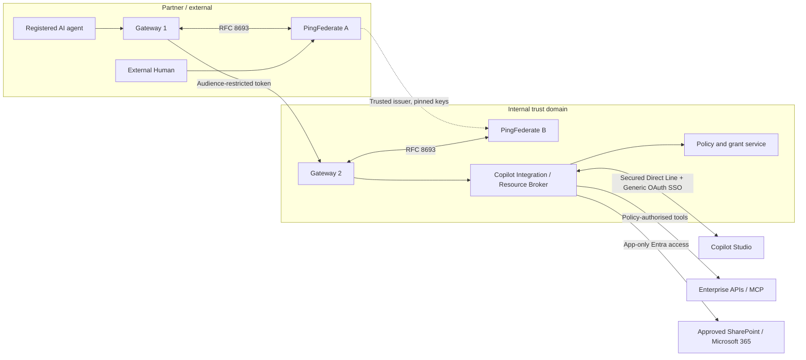

# Architecture and Trust Model

## Trust domains

## Two identity planes

**Delegated identity plane**: external PingFederate establishes human identity; external agent uses independent credential; PingFederate A issues a token for Gateway 2; PingFederate B validates the upstream chain and issues token for the broker; policy engine checks current delegation and entitlements for every tool call.

**Microsoft resource plane**: broker authenticates to Entra as a dedicated **application**. Graph app-only token allows selected resources only. Broker's user-specific policy is separate and strictly additive. It is false to claim Graph acts as the external user: Graph evaluates the app's permissions.

## Two execution modes

Interactive: current user proof + agent proof + active grant; exchange subject and actor tokens.

Autonomous: authenticated agent + durable, revocable grant; trusted authority issues a short-lived subject assertion bound to the original user, actor and grant; token exchange validates that assertion. Never reuse a stale interactive access token as durable proof.

## Mandatory claim invariants

- `sub` = original human, immutable issuer-qualified identity
- `act.sub` = original registered external agent, not Gateway 1 or Gateway 2
- `iss` = *actual* token issuer at current hop
- `aud` = exactly the receiving resource; no forwarding of upstream token
- `delegation_id` = verified, active grant ID, not a free-text claim
- `execution_mode` = interactive/autonomous; logged and enforced
- `scope` = derived from grant and resource policy; can only narrow
- `jti`, short expiration, bounded clock skew and replay policy

## Production boundary register

| Boundary | Authentication | Authorisation | Additional proof |
|---|---|---|---|
| Agent → Gateway 1 | mTLS/private_key_jwt/workload JWT | Agent registry and user grant | Human interaction or stored grant |
| Gateway 1 → PF A | Confidential OAuth client | Token exchange processor policy | Subject + actor |
| Gateway 1 → Gateway 2 | Audience-scoped PF A JWT + sender authentication | Partner and workload allowlist | Delegation |
| Gateway 2 → PF B | Confidential OAuth client | Trusted issuer, policy, scopes | Verified PF A JWT |
| Gateway 2 → broker | Local audience-scoped PF B JWT + sender authentication | Broker policy engine | Grant/current entitlements |
| Broker ↔ Copilot Studio | Secured Direct Line, Generic OAuth SSO | Channel session binding | Verify live channel behaviour |
| Copilot tools → broker | Audience-specific token | Per-operation PDP evaluation | Original actor, grant, resource |
| Broker → Graph | Entra application-only access token | `Sites.Selected` + external PDP | Approved site IDs and resource scope |

## Limits

Do not assume native Copilot SharePoint knowledge can respect external PingFederate-only users. Use broker tools for SharePoint. Do not assume Direct Line token-post works for autonomous issuance until live-tested. If product constraints block unattended SSO, consider an alternate Copilot channel/integration or move autonomous orchestration into a controlled API service; never bypass authentication.
