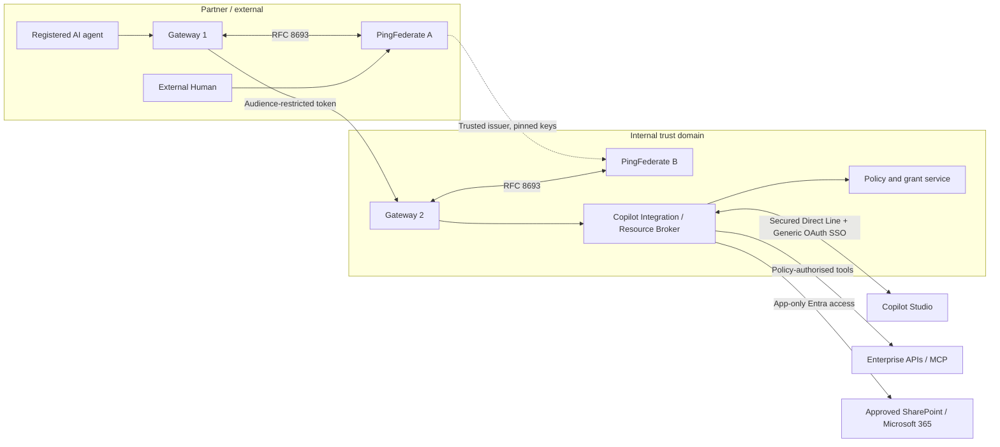

# Architecture and Trust Model

Latest verified scope (3 November2026): [one interactive document-backed Copilot answer](document-chat-live-success.md) passed through actual Vault/PF A/PF B policy authorization, the Sites.Selected app-only broker, the single pinned synthetic SharePoint sample and a fresh Direct Line/Generic OAuth session. Independent audit confirms human/agent/grant continuity, both grants revoked, request caps respected and owned PF/private services restored. The server supplied approved text as context; no native SharePoint tool, arbitrary search or ongoing chat was enabled. Production isolation and Microsoft trace protection remain unverified. The following checkpoints describe earlier milestones.

Earlier Microsoft handoff checkpoint: [actual interactive Copilot delegated execution passed](copilot-interactive-tool-success.md) on1 November2026 Australia/Sydney. One fresh OAuth-card token POST returned200; the published connector delivered the exact bound provider token through PfUserAccessToken; real PF A/B and the private tool returned the fixed diagnostic with independently verified human/actor/organisation/grant/mode/resource/audience continuity. Exactly one origin success and cleanup were independently confirmed. Autonomous Copilot provider SSO, live Microsoft expiry/revocation behavior and production isolation remain UNVERIFIED; Graph is not connected. The explicit PoC credential-trace exception remains, and all three automated tool-test allowances are consumed.

The checkpoints below describe earlier milestones and their verification limits at those stages; the current verified scope is defined above.

Latest transport checkpoint: the [private gateway HTTP handoff](copilot-gateway-handoff.md) now requires both pinned mTLS identity and an exact-body signed envelope. Actual loopback control-plane to Vault/PF A/PF B/private Docker tool passed 17 checks, with owned-grant revocation and cleanup. Persistent controller/container hosting and Copilot-originated invocation remain UNVERIFIED.

Latest local verification: the [durable gateway handoff and retained-agent exchange](copilot-gateway-handoff.md) now passes through actual Vault custody, independent agent/human/broker validation, PF A/B and private Docker tool, with 15 checks passing twice. Permanent authenticated gateway transport and relay hosting remain UNVERIFIED; no Microsoft tool invocation was attempted.

Real local relay checkpoint: [actual PF A/B issuer-to-private-tool flow](copilot-real-relay.md) now passes through authenticated loopback relay ingress and enrolled private mTLS workload, retaining original human/actor/grant and independent pre/post policy. One synthetic grant was revoked and existing-token/new-issuance denial verified. This uses a bounded operator test transport; permanent relay hosting/control-plane wiring and Microsoft-originated invocation remain unverified.

Current Copilot boundary: interactive Generic OAuth sign-in is verified for one approved live run. The [prepared tool relay](copilot-tool-relay.md) correlates an exact provider-token fingerprint with an independently verified broker human/actor/grant, requires a separately authenticated connector caller, and compares fresh tool-audience proof before fixed private invocation. The [HTTPS/lifecycle composition](copilot-tool-relay-hosting.md) wires registration/close hooks and a pinned private mTLS client in an explicit factory, with passing loopback tests. No persistent listener or running-controller installation has occurred; Copilot-originated tool access, autonomous provider SSO and Graph remain unverified/disconnected as applicable.

## Trust domains

## Two identity planes

**Delegated identity plane**: external PingFederate establishes human identity; external agent uses independent credential; PingFederate A issues a token for Gateway 2; PingFederate B validates the upstream chain and issues token for the broker; policy engine checks current delegation and entitlements for every tool call.

**Microsoft resource plane**: broker authenticates to Entra as a dedicated **application**. Graph app-only token allows selected resources only. Broker's user-specific policy is separate and strictly additive. It is false to claim Graph acts as the external user: Graph evaluates the app's permissions.

## Two execution modes

Interactive: current user proof + agent proof + active grant; exchange subject and actor tokens.

Autonomous: authenticated agent + durable, revocable grant; trusted authority issues a short-lived subject assertion bound to the original user, actor and grant; token exchange validates that assertion. Never reuse a stale interactive access token as durable proof.

## Mandatory claim invariants

- `sub` = original human, immutable issuer-qualified identity
- `act.sub` = original registered external agent, not Gateway 1 or Gateway 2
- `iss` = *actual* token issuer at current hop
- `aud` = exactly the receiving resource; no forwarding of upstream token
- `delegation_id` = verified, active grant ID, not a free-text claim
- `execution_mode` = interactive/autonomous; logged and enforced
- `scope` = derived from grant and resource policy; can only narrow
- `jti`, short expiration, bounded clock skew and replay policy

## Production boundary register

| Boundary | Authentication | Authorisation | Additional proof |
|---|---|---|---|
| Agent → Gateway 1 | mTLS/private_key_jwt/workload JWT | Agent registry and user grant | Human interaction or stored grant |
| Gateway 1 → PF A | Confidential OAuth client | Token exchange processor policy | Subject + actor |
| Gateway 1 → Gateway 2 | Audience-scoped PF A JWT + sender authentication | Partner and workload allowlist | Delegation |
| Gateway 2 → PF B | Confidential OAuth client | Trusted issuer, policy, scopes | Verified PF A JWT |
| Gateway 2 → broker | Local audience-scoped PF B JWT + sender authentication | Broker policy engine | Grant/current entitlements |
| Broker → Direct Line | Secret-manager channel secret for generation; scoped channel token afterwards | Verified local session bound to human/actor/grant/org/mode and current PDP | Implemented adapter/API factory; actual tenant UNVERIFIED |
| Broker → Generic OAuth secure token-post endpoint | Configured HTTPS destination; separately verified PF SSO/tool token | Approved bot/conversation/challenge and current PDP | Distinct tool audience; HTTP post alone is not authentication proof |
| Broker ↔ Copilot Studio | Secured Direct Line, Generic OAuth SSO | Channel session binding | Verify live channel behaviour |
| Copilot tools → broker | Audience-specific token | Per-operation PDP evaluation | Original actor, grant, resource |
| Broker → Graph | Entra application-only access token | `Sites.Selected` + external PDP | Approved site IDs and resource scope |

## Limits

The [tool deployment review](tool-api-deployment-review.md) proposes isolated hosting and loopback-only publication with no public route. It explicitly separates authenticated gateway workload identity from the still-unverified Copilot caller path, and records unresolved runtime deployment acceptance, private PDP/JWKS routing, secret custody, admission controls, monitoring and ownership. The dedicated tool runtime/config loader and Docker image are now implemented and smoke-tested; the Compose service remains unstarted. The draft and offline checker do not deploy or establish production readiness.

The [protected tool HTTP API](protected-tool-api.md) now implements one fixed read-only diagnostic behind independent tool-token verification/online policy and mandatory CA-validated, certificate-pinned mTLS workload authentication. Its factory opens no listener. Real loopback HTTPS and signed-token/policy contract tests pass; deployment and actual Copilot-originated token delivery remain UNVERIFIED. No Graph/SharePoint operation is implemented by this endpoint.

The [dedicated tool authority](copilot-tool-authority.md) now verifies real PF tool-token issuance and tool-result release with independent HTTPS policy decisions before/after each boundary. An explicit isolated local profile accepts only the pinned public-tool issuer/audience/key for the consent-backed human and approved resource. Existing/default policy trust remains unchanged. Production tool HTTP ingress and actual Copilot token delivery remain unverified.

The [real PF container profile](pingfederate-containers.md) verifies issuance/exchange at `https://localhost:9033` and `https://localhost:9034`. The [consent portal](browser-consent.md) at `https://localhost:9460` uses actual PF A login and human approval backed by the [transactional policy service](delegation-policy.md). Gateway 2 supplies signed token evidence before and after issuance. Retained synthetic fixtures use separate authority keys/profiles. Production directory/session policy, HTTP hosting, signing custody and operations remain approval/backlog work; this does not connect Copilot or Microsoft 365.

Do not assume native Copilot SharePoint knowledge can respect external PingFederate-only users. Use broker tools for SharePoint. Do not assume Direct Line token-post works for autonomous issuance until live-tested. If product constraints block unattended SSO, consider an alternate Copilot channel/integration or move autonomous orchestration into a controlled API service; never bypass authentication.

The [authority service](authority-service.md) exposes authenticated POST /v1/assertions on the configured HTTPS policy origin. Separate agent credentials, body-bound signatures and persistent replay protection precede consent-backed issuance. The exchange caller has no authority-key or database dependency. The [actual local Vault profile](vault-containers.md) verifies non-exportable signing, sign-only credentials, outages/recovery and authority/PF A rotation; production OS isolation and deployment remain UNVERIFIED.

The [persistent local tool backend](persistent-tool-backend.md) now has a separate loopback policy profile with no fixture grants, durable registry/replay state, immutable public workload trust and a separately revoked-on-stop Vault signing lease. Dedicated local TLS/tool credentials are enrolled in Vault; only six rendered runtime files are delivered to the tool. The three private maintenance records are denied to its reader. No continuous service or private Docker bridge is activated by this milestone, and Copilot caller authentication remains unverified.

The [local tool controller](local-tool-controller.md) now coordinates the enrolled private Docker path and durable PDP, with owned resource labels, shared shutdown completion, explicit bounded lease lifetime and refusal to recover live/foreign instances. Actual cold-process recovery retires its tracked lease and preserves audit. It has no public tool listener, automatic renewal/restart or Windows autostart; continuous startup awaits the explicit service/audit owner and retention choice.

Generic OAuth correction (2026-10-31): Copilot sign-in now uses a separately verified PF A user token (api://copilot-login, copilot.login) bound through a trusted identity mapping to the full PF B broker context. Delegated PF B tool JWTs (api://copilot-tool) retain human/actor/org/grant/mode and online policy and are never posted as provider user proof. The provider token is not tool/Graph authority. Actual Copilot-to-tool credential handoff and unattended provider sign-in remain UNVERIFIED; autonomous provider SSO fails closed while local autonomous grant-backed tool execution remains supported. See docs/copilot-provider-token-fix.md.

## Live browser verification - 2026-11-01

The interactive browser diagnostic at agent.copilot.darkedges.com is VERIFIED_POC with independent original-human/acting-agent/grant identity audit and completed grant/PF-client cleanup. See docs/portal-browser-success.md. The run allowance is spent; this does not authorize subsequent tests, autonomous SSO or Graph access, and does not establish production credential-trace protection or OS isolation.

## Prepared repeatable session controls - 2026-11-02

A separate repeatable profile is implemented locally with618 passing production tests and372 simulation tests. The proposed first activation permits five fresh consent/session attempts in one fixed hour, one active at a time; each has one conversation/POST/check and independently confirmed cleanup. Earlier spent journals are unchanged. Versioned session state blocks replay/concurrent reservations, lost-response uncertainty and restart resumption; metadata maintenance preserves pending ownership and spent quotas. New profile and exact current OIDC public-key pin refresh are prepared for approval, not deployed. Multi-session live acceptance remains UNVERIFIED. See docs/portal-repeatable-sessions.md and docs/portal-repeatable-session-review.md.
