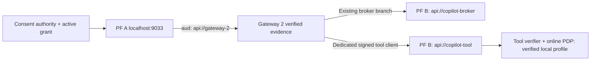

# Dedicated Copilot PF profiles — public human login verified

Current lifecycle: the dedicated PF A human-login client is enabled and its complete public authorization-code/JWT flow plus replay, bad-secret and redirect negatives pass. The tool client remains disabled. Microsoft callback redemption, tenant authentication and delegated SSO acceptance are still UNVERIFIED. Use [the manual Copilot settings](copilot-generic-oauth-settings.md) for the next operator step; the disabled-client/local-only evidence below records earlier milestones.

Edge update (2026-10-30): the reviewed ingress is now active after explicit user approval. Public metadata/JWKS, exact issuer origins, allowed assets, anonymous-token rejection and denied routes pass fifteen checks. Both dedicated clients remain disabled; no new-client sign-in through the edge or actual Copilot federation is claimed. See `cloudflare-activation-review.md` for current state and rollback.

The actual PF A/B containers now support the proposed public hostnames through additive virtual issuers and virtual-host settings. Global localhost base URLs, existing clients and existing policy trust registries remain unchanged. Tests connect only to loopback with verified TLS/SNI `localhost` and the exact public Host header; they make no public DNS, Cloudflare or Microsoft callback requests. Public edge connectivity and live Copilot federation remain **UNVERIFIED**.

Both dedicated clients return to **disabled** after the controlled verification run. The Cloudflare connector remains deny-all, with no DNS/forwarding changes.

| Profile | PF | Authentication / grant | Token issuer / audience |
|---|---|---|---|
| Human login | A | Dedicated secret / authorization code only | `https://pf-a.copilot.darkedges.com` / `api://copilot-login` |
| Delegated tool | B | Separate RS256 private_key_jwt with replay prevention / token exchange only | `https://pf-b.copilot.darkedges.com` / `api://copilot-tool` |

Human client `copilot-studio-generic-oauth` permits only `copilot.login` and callback `https://token.botframework.com/.auth/web/redirect`. The verified browser flow captures that callback locally without contacting Microsoft, redeems the actual code, verifies the signature/issuer/audience/subject and rejects code reuse. Its token has no actor, organisation, grant or mode and is rejected by the delegated tool exchange. There is no refresh grant. The original consent portal's mandatory PAR/PKCE policy is unchanged. See [Microsoft's manual-authentication fields](https://learn.microsoft.com/en-us/microsoft-copilot-studio/configuration-end-user-authentication).

## Delegated tool branch and lifetime cap

The initially staged broker-to-tool chain was revised after the installed PF plugin rejected fractional-minute lifetimes (HTTP 422: integer required). Two consecutive one-minute tokens cannot reliably narrow expiry. The dedicated client `copilot-sso-exchange` now consumes a fresh consent-backed **PF A** token for `api://gateway-2`, signed by the pinned `consent-a-signing` key using RS256. It branches at Gateway 2 rather than converting the one-minute broker token.

The tool manager copies original `sub`, `act`, organisation, delegation ID, mode and scope from verified PF A proof. Resource selection is `urn:copilot:delegated:tool`, scope is only `copilot.invoke`. The existing synthetic lab identity constraints remain; this is not a production partner registry.

PF's documented JWT `exp` contract accepts a lifetime in **minutes**, not an epoch timestamp. The mapping uses the verified upstream `exp`, subtracts a ten-second processing budget, rounds down to whole minutes and caps issuance at two minutes. An issuance criterion rejects remaining proof lifetime below 75 seconds or above 185 seconds. Errors/missing expiry fail issuance. The real signed-proof aging test confirms a still-valid proof with about 72 seconds remaining is rejected. Output signature, issuer, audience, human/actor identity and expiry narrowing are checked for actual interactive and autonomous tokens. The existing adapter's independent no-expiry-extension check remains unchanged. See [PingFederate JWT token lifetime](https://docs.pingidentity.com/pingfederate/12.3/administrators_reference_guide/pf_configuring_access_token_management_instance.html).

Separate certificates and exchange workload keys remain under the lab profile. Private credentials live only in ignored `.local/copilot/` under the protected current-user/SYSTEM DACL; no values are printed or committed. Production requires secret-manager/signing-service custody. Added signing keys do not replace existing keys. The online authority verifies consent when fresh PF A proof is acquired, but the new public-tool issuer is not yet trusted by the runtime PDP. Raw protocol issuance tests do not claim authorization to release or consume a tool token in production.

## Commands and recovery

- `npm run copilot:pf-plan`: fixed non-secret preview, no PF requests or credential creation.
- `npm run copilot:pf-stage`: first-time disabled staging only. Refuses existing objects/credentials/receipts; records intent before mutation; no POST retry.
- `npm run copilot:pf-reconcile-plan`: preview the additive virtual issuer and bounded-proof update. The corresponding script's `--apply-disabled` mode requires both dedicated clients disabled and writes a private before-state receipt. It changes no base URL or public route. An inspected one-off `--resume-disabled` supports only the exact recorded partial state; do not delete receipts or retry blindly.
- `npm run copilot:pf-verify`: controlled local protocol verification. Temporarily enables only the dedicated clients, creates an isolated policy database, verifies real login/issuance and aged-proof rejection, then restores and verifies both clients disabled. An exclusive lease and recovery receipt prevent overlapping/uncertain runs. Idempotent disable/verification has at most three bounded attempts. If interrupted, inspect the receipt and disable both clients before clearing an active lease. Never expose these clients while running the harness.
- `npm run copilot:pf-test`: read-only staging/disabled-client rejection checks after verification, including unchanged existing clients.

Run the live profile suite and `npm run pf:test` **sequentially**: both use the isolated consent test listener on port 9461. A concurrent run produces a listener conflict rather than an identity regression.

Final validation on 2026-10-29: 94 baseline tests, all six new local protocol tests, four post-run disabled-client checks and all 35 original PF regression tests pass. The successful verification receipt confirms both clients disabled, no cleanup failures and exit code 0. Existing simulation code/configuration remains isolated and unchanged.

## Remaining deployment work — UNVERIFIED

1. Local metadata now reports exact public issuers and public authorization/token/JWKS URLs, while localhost metadata remains unchanged. Verify the same behavior through the real edge after approved activation; local Host-header routing is not external TLS/network verification.
2. The real login requires `/as/{transaction}/resume/as/authorization.ping`. Its bounded path shape is included only in the inactive PF A ingress candidate. Full rendered-browser assets, cookies and edge certificate coverage still need review. No session transaction identifiers are retained in the path summary.
3. The [tool verifier and online PDP](copilot-tool-authority.md) are now integrated and verified in the explicit isolated local profile, including issuance/execution revocation races, suspension and actual policy outage. Default policy trust and existing registries are not silently expanded. Production tool HTTP ingress, custody and Copilot token delivery remain unverified; never bypass policy or reuse the broker audience.
4. Prepare and approve the concrete DNS/local-ingress exposure plan before activation. Shared Cloudflare resources and the source Terraform project remain unchanged. Keep existing lab accounts, runtime-only paths and rollback explicit.
5. Configure Generic OAuth and republish the actual Copilot agent only after approved connectivity and the complete authorization path are verified. Test real token-post challenges, both execution modes, token expiry and tool-side rejection. No new production integration listener is deployed.
