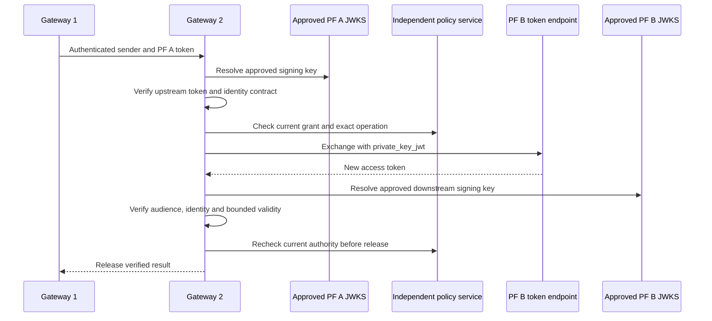
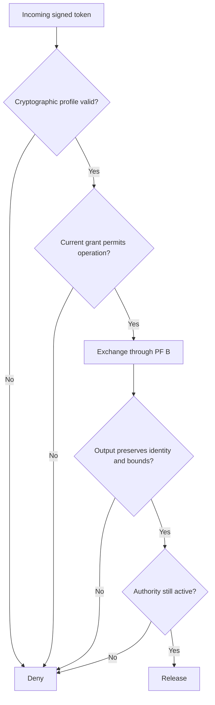

Part 1 defined the identity contract. This part puts actual PingFederate servers behind it.

The objective was narrow: implement the Gateway 2 exchange adapter, trust only approved issuers and JWKS, authenticate the confidential client with a signed JWT, and preserve the original human and actor. The local simulation had to continue working.

The container lab used PingFederate 13.1.0 on an existing Windows Docker host. That version describes the tested lab, not a recommendation to ignore later patches or your organisation's supported release policy.

## Step 1: Create an explicit adapter boundary

The real implementation lives behind typed contracts in `src/adapters/token-exchange.ts`. The JOSE implementation, configuration loader and mode selection are separate modules.

```typescript
// Abbreviated interface, not the repository's full exported type.
interface ExchangeAdapter {
  exchange(upstreamBearer: string): Promise<VerifiedExchangeResult>;
}
```

Mode selection is explicit. A production configuration cannot silently fall back to mock behavior when JOSE is missing, JWKS is unreachable or the token endpoint fails.

Install the optional real-adapter dependencies and run their tests separately:

```powershell
npm ci --include=optional
npm run test:production
```

The baseline `npm test` path remains separate. The real adapter does not import development private keys, fixture grants or the mock JWT helper.

## Step 2: Prepare two independent PF containers

We reused the preparation approach from an existing local PingFederate PAR proof of concept. We did not modify its containers or reuse its runtime state as our own deployment.

The project-specific flow was:

```powershell
npm run pf:prepare
npm run pf:up
npm run pf:test
npm run pf:status
```

These are lab provisioning commands. Review their fixed object IDs, licensing inputs, TLS files and configuration before running them in another environment.

The preparation step places private inputs in ignored local storage. It creates independent admin credentials and preserves the named volumes alongside their associated keys. It does not print passwords or produce shareable credential fixtures.

| Component | Runtime | Administration |
|---|---|---|
| PF A | `https://localhost:9033` | `https://localhost:9996` |
| PF B | `https://localhost:9034` | `https://localhost:9997` |

All host mappings bind to `127.0.0.1`. Outbound requests verify the local CA. A self-signed lab certificate is not a reason to set TLS verification to false.

Each domain has its own signing objects, exchange processors, policy mappings and confidential client. A successful exchange in one domain must not collapse the second domain's validation boundary.

## Step 3: Configure trust as deployment data

An upstream trust entry specifies the issuer, JWKS URI, exact audience, allowed algorithm, allowed key IDs, actor namespace, organisation and maximum lifetime.

```json
{
  "issuer": "https://pf-a.example.com",
  "jwksUri": "https://pf-a.example.com/pf/JWKS",
  "audience": "api://gateway-2",
  "algorithms": ["RS256"],
  "keyIds": ["pf-a-current", "pf-a-next"],
  "organisations": ["partner-a"],
  "actorIssuers": ["https://partner-a.example/agents"],
  "maxLifetimeSeconds": 180
}
```

This is an illustrative entry, not a complete environment configuration. The downstream profile is independent and targets the broker audience.

We reject token-controlled `jku`, embedded JWKs and alternate certificate URLs. A header can identify an approved key by `kid`; it cannot choose where the verifier fetches trust.

The validator checks signature, issuer, single exact audience, algorithm, key ID, validity, replay identity and the required delegation claims. Decoding a JWT is never treated as validation.

## Step 4: Keep three audiences separate

The live container tests exposed a distinction that is easy to lose in a mock:

| Audience | Purpose |
|---|---|
| `api://gateway-2` | Who may consume the upstream access token |
| Configured PF B authorization-server audience | Who may consume the client-authentication assertion |
| `api://copilot-broker` | Who may consume the exchanged access token |

For our tested PF configuration, client authentication used the server base URL as the assertion audience. It did not use the broker audience. This is a configured interoperability choice, not a general instruction to change every OAuth client's audience.

The client assertion uses the registered client ID as issuer and subject, a short expiry, a fresh `jti`, and the client's pinned signing key:

```typescript
// Illustrative construction. Obtain privateKey from approved custody.
const assertion = await new SignJWT({})
  .setProtectedHeader({
    alg: 'RS256',
    kid: clientKeyId,
    typ: 'client-authentication+jwt'
  })
  .setIssuer(clientId)
  .setSubject(clientId)
  .setAudience(configuredAssertionAudience)
  .setIssuedAt()
  .setExpirationTime('60s')
  .setJti(crypto.randomUUID())
  .sign(privateKey);
```

The explicit `typ` mattered in this lab: the tested PF configuration rejected a generic `JWT` value for this authentication use. That observation belongs beside the version and configuration, not in a universal OAuth rule.

## Step 5: Send the exchange request once

The request uses the token-exchange grant and signed client authentication:

```text
grant_type=urn:ietf:params:oauth:grant-type:token-exchange
subject_token=<verified-upstream-token>
subject_token_type=urn:ietf:params:oauth:token-type:access_token
requested_token_type=urn:ietf:params:oauth:token-type:access_token
client_id=<registered-gateway-client>
client_assertion_type=urn:ietf:params:oauth:client-assertion-type:jwt-bearer
client_assertion=<fresh-signed-client-assertion>
resource=<administrator-configured-target>
scope=copilot.invoke
```

This is a request shape. It intentionally contains no reusable values.

Our PF access-token-manager selection required `resource`. Sending an `audience` parameter did not select the intended manager in that profile. We made the target parameter configurable and trusted configuration, while retaining strict validation of the resulting JWT audience.

We do not retry a token POST after an uncertain response. A lost response could mean issuance succeeded. Network GETs for JWKS have narrowly bounded retry behavior; credential-bearing issuance is a different operation.

## Step 6: Validate the result independently



An HTTP 200 response does not bypass output validation. We check that the exchanged token carries the same human, original actor and actor issuer, organisation, grant and mode. It must have the intended scope and audience and must not extend authority beyond the applicable parent evidence.

Both policy checks matter. A grant might be revoked while PF is processing issuance. The post-issuance check prevents a newly issued token from escaping under authority that disappeared during the call.

## Step 7: Exercise the negative matrix against real PF

The tests cover wrong issuer, audience, algorithm and key ID; missing or substituted actor; scope expansion; unknown resource; expired input; changed organisation; client assertion replay; and revocation before or during issuance.



We also test redirect refusal, TLS failures, bounded timeouts and key rotation overlap. Stable error codes cross the adapter boundary; raw token responses, form bodies and private keys do not enter logs.

For configuration work, dependent objects are staged with clients disabled. We record intent before mutation, read back actual state and refuse to turn an uncertain write into an automatic second creation.

## What the container result proves

The real PF A and PF B chain works in the local lab for the tested interactive and grant-backed autonomous profiles. It preserves the human and actor and enforces current policy.

It does not prove production hosting, Microsoft authentication or document access. Those are separate integrations.

Part 3 gives the grants and signing keys durable ownership through the policy service and Vault. For protocol background, see [RFC 8693](https://datatracker.ietf.org/doc/html/rfc8693) and the [PingFederate token endpoint documentation](https://docs.pingidentity.com/pingfederate/13.1/developers_reference_guide/pf_token_endpoint.html).
