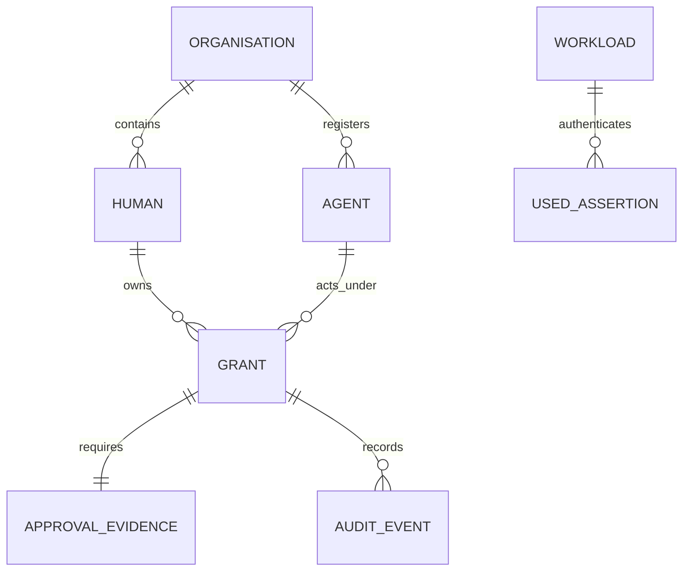
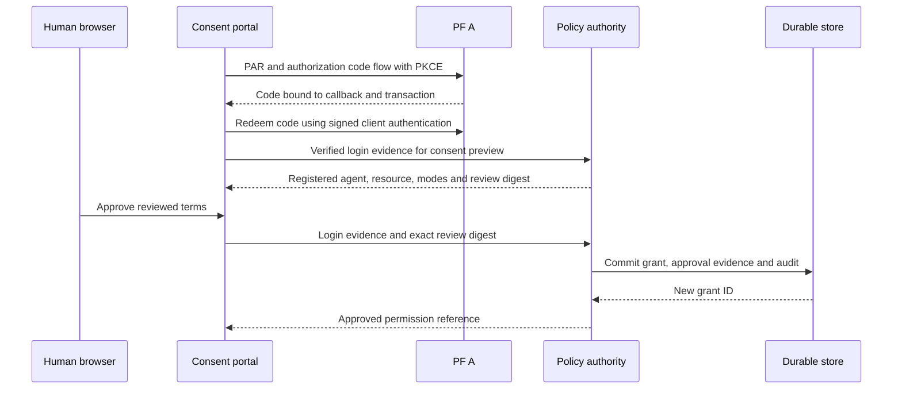
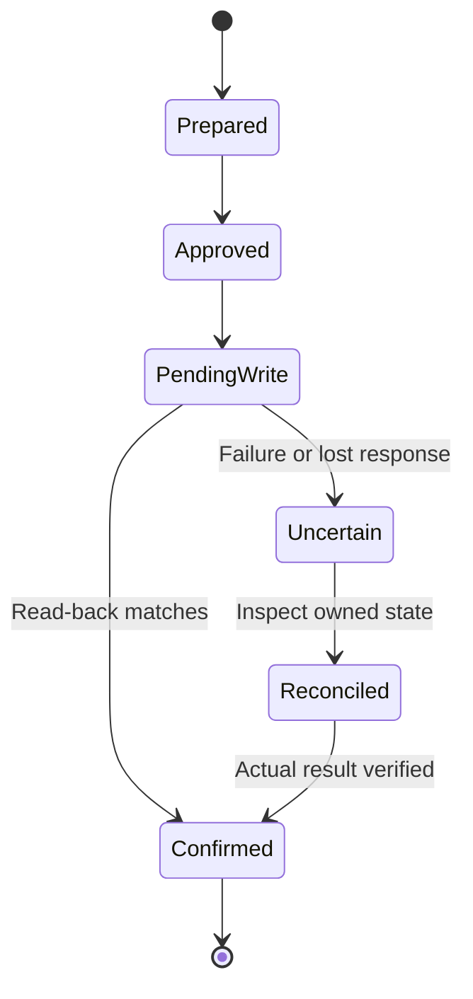

Real token exchange answers whether two identity domains can exchange signed evidence. It does not answer who owns a grant, how revocation survives a restart or which process may use a signing key.

This part adds those missing controls: persistent policy, a human consent flow, an authenticated assertion authority and scoped Vault custody.

## Step 1: Make the registry authoritative

We built a transactional store around organisations, external humans, registered agents, grants, approval evidence, consumed assertion identifiers and audit records.

An external principal is an immutable issuer, subject and organisation binding. An agent has its own independently registered issuer and subject. Registry records can be suspended; a request cannot repair or reactivate them.



The diagram is a conceptual relationship map. The implementation also tracks consent references, versions and profile-specific state needed for recovery and replay rejection.

SQLite is suitable for this single-host PoC because transactions can make a policy decision and its audit event commit together. The store uses prepared statements, foreign keys, bounded locking, WAL and full synchronous commits. It is not a claim of multi-region availability or safe operation on a network filesystem.

Registry and grant decisions have no permit cache. A service outage or unavailable database denies the operation rather than reusing yesterday's permission.

## Step 2: Authenticate the policy request itself

A gateway's access to the policy API does not let it submit arbitrary identity claims and ask for a Boolean answer. The policy service independently verifies the signed PF token evidence.

The caller also signs its HTTP request. In this implementation the request JWT binds:

- The registered workload ID as issuer and subject.
- The exact configured endpoint audience.
- The method and SHA-256 hash of the exact body bytes.
- A short validity interval and unique, persistently consumed `jti`.
- A fixed signing type, algorithm and key ID.

This protects a different boundary from the delegated access token. The workload signature authenticates who is asking for a decision. The PF token and current database establish whose delegated operation is being evaluated.

Decision callers cannot register principals or create grants. Consent callers cannot silently become registry administrators. Roles are also organisation-scoped.

The resulting separation is visible in the API design:

| Operation | Caller role | Key restriction |
|---|---|---|
| Evaluate one capability | Decision workload | Verify token evidence and current grant |
| Preview human consent | Consent workload | Independently verify current OIDC login |
| Approve or revoke owned consent | Consent workload | Bind the verified owner and reviewed terms |
| Register principals | Registry administrator | No public application access |
| Administrative grant management | Grant administrator | Explicitly separate administrative authority |

## Step 3: Add real human login

The browser portal uses PF A Authorization Code flow with required PAR and S256 PKCE. The client authenticates with a signed JWT. State, nonce and PKCE verifier are server-held and tied to the initiating browser transaction.

For the prepared local lab:

```powershell
npm run pf:configure
npm run consent:serve
```

These commands reconcile local PF configuration and start a local consent portal. They should not be run over a later active profile without reviewing their lifecycle assumptions.

The initial browser flow has two separate decisions. PF authenticates the human and authorizes the identity request. The application then asks whether the registered agent may perform a specific resource operation for a stated period.

We verify signature, exact issuer and client audience, nonce, recent `auth_time`, token validity and `at_hash` when present. We do not use an email string from the page to locate or provision an Entra account.

Cookies are secure, HTTP-only, host-only and SameSite=Lax. State-changing forms require the expected origin and session-bound CSRF. Extra form fields that attempt to supply human, actor, scope or resource authority are refused.

## Step 4: Bind consent to the review the human saw



A review digest ties the decision to the login, human, agent, resource and allowed options. Approval does not silently expand if server policy changes between rendering and submission.

The initial browser implementation allowed explicit durations and a separate background-execution opt-in. The later mobile profile has a different, disclosed default-on approval preference for fixed capabilities. Those are separate consent designs, not a retroactive change to historical grants.

Approval evidence records digests and provenance rather than raw ID tokens. A consumed login cannot mint another unrelated grant. Revocation is permanent for the grant ID.

## Step 5: Issue fresh assertions under current authority

The registered agent authenticates to the assertion authority and supplies its independent actor proof. The authority resolves the human from the grant, checks current organisation and principal state, validates the requested mode and operation, then signs a short-lived assertion.

The authority checks again before releasing the result. A grant revoked during signing must not produce usable released evidence.

The gateway no longer opens the policy database or imports the authority's private key merely to request an assertion. The signing dependency has an interface, so local development and Vault-backed execution remain explicit choices rather than fallback paths.

Autonomous assertion issuance does not replay a stored browser login token. It relies on a grant that permits autonomous work, current independent agent authentication and fresh issuance. This local capability must still be distinguished from unverified autonomous Copilot provider SSO.

## Step 6: Introduce Vault by key purpose

We used actual local Vault services to exercise non-exportable signing, scoped credential reads, denial cases, outages and rotation.

Vault Transit owns dedicated assertion signing keys. The workload can ask to sign at an allowed path but cannot export the key. This is the relevant property of [Vault Transit](https://developer.hashicorp.com/vault/docs/secrets/transit), rather than treating the entire secret manager as one unlimited key store.

Other credentials in this PoC have different custody. PF client private keys and the Graph broker certificate key are stored in protected KV records and retrieved by authorized server processes. They are exportable to those processes. They must not be described as non-exportable Transit keys.

The mobile deployment eventually separated five certificate-authenticated roles:

| Role | Access |
|---|---|
| Runtime reader | One use, short-lived read of the exact mobile runtime record |
| Provider store | Read and CAS-update only mobile provider session records |
| Agent signer | Sign with the dedicated agent Transit key |
| Authority signer | Sign with the dedicated authority Transit key |
| Graph reader | One use, short-lived read of the existing broker credential record |

The cert login mechanism is documented in [Vault TLS certificate authentication](https://developer.hashicorp.com/vault/docs/auth/cert). Our exact policies, lease ceilings and record boundaries are project-specific.

A narrow policy example illustrates the intent:

```hcl
# Illustrative policy for one reader, not an operator policy.
path "mobile-runtime/data/credentials" {
  capabilities = ["read"]
}
```

A reader should fail to list unrelated secrets, write its own policy, read the Graph key through the wrong role or sign with another purpose's key. Those denials are part of verification.

## Step 7: Handle leases and secret versions deliberately

Reusable workload leases are short-lived and reauthenticated before expiry. A certificate login returning unexpected policies, excessive lifetime or an invalid use count is rejected. A failed renewal clears usable in-memory authority and stops the service.

Unattended runtime startup does not use a root token, bootstrap credential or automatic unseal operation. Host availability and Vault seal recovery remain operational responsibilities.

For mutable provider records we use compare-and-set. Before transmitting a rotating refresh token, the store records it as spent. If the response is lost, the application requires a new sign-in instead of using the same refresh token again.

For enrollment and IAM changes we retain a durable progression:



The state machine intentionally has no "clear the file and try again" transition.

## Step 8: Minimize audit without losing revocation history

Operational audit records contain fixed outcomes and pseudonymous references, not tokens, questions or document excerpts. The selected local retention is one day, with a small bounded journal.

Replay state, revoked grant records and usage counters have different purposes. Deleting audit events must not reactivate a grant, erase a consumed assertion prematurely or reset the demo allowance.

The Windows custody directory is restricted to the owner and SYSTEM. We also encountered a practical ACL error: trying to read or apply security information unnecessarily requested a privilege the process did not have. The repair constructed the required discretionary ACL directly rather than attempting a broader privileged operation.

This remains a shared-host PoC. ACLs, Vault roles and application checks do not establish isolation from a fully privileged administrator.

## What is verified at this boundary

The local system has real consent, persistent revocation, independently authenticated policy requests and Vault-backed signing. Tests cover wrong callers, actor substitution, replay, expiry, suspension, signing failure and revocation during asynchronous work.

The next challenge is Microsoft-specific: a valid delegated PF token is not necessarily the credential Copilot Studio expects for sign-in. Part 4 follows that integration and the failures that exposed the difference.
