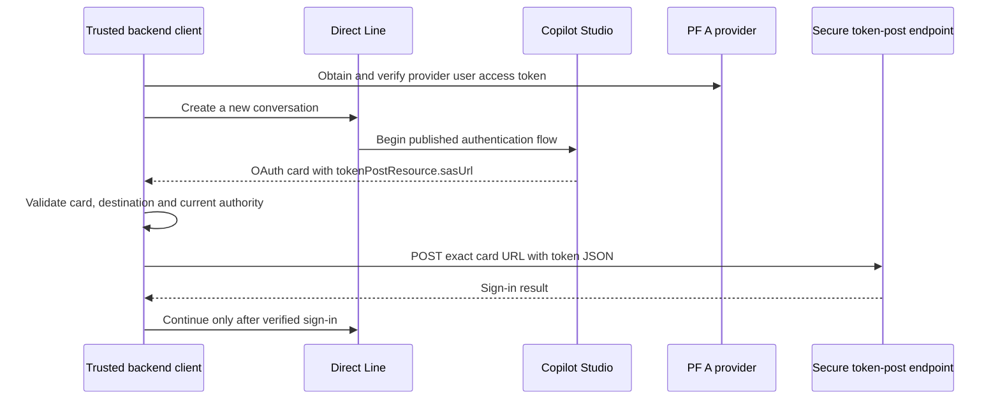
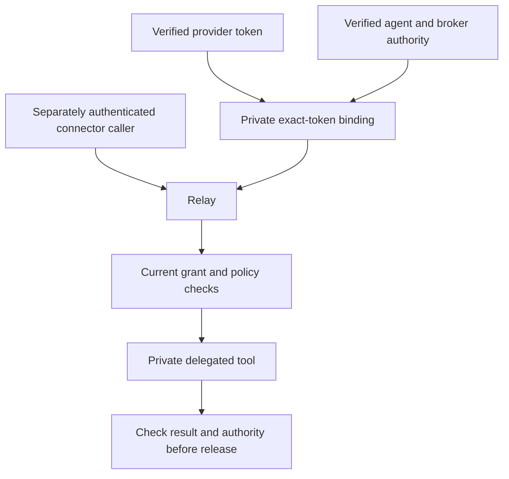

The most time-consuming part of the integration was not generating another JWT. It was proving that the particular credential sent to a Microsoft endpoint belonged at that endpoint.

We had already verified real PF exchanges and policy. Copilot Studio still returned HTTP 400. Later, sign-in worked while a connector returned HTTP 401. Each result described a different boundary.

## Step 1: Establish the Microsoft environment

The project began without a usable Copilot Studio environment. We prepared Power Platform tooling and an environment plan, then worked through the actual tenant's capacity, maker access, licensing and publishing requirements.

An Azure subscription alone did not prove Dataverse capacity or a Copilot maker entitlement. The observed errors included a self-service signup requirement and `User license not found` while creating or saving an agent.

The practical sequence was to verify the signed-in tenant and account, inspect environment capacity, configure the approved billing or licensing arrangement, grant the maker access allowed by tenant policy, and publish a dedicated test agent.

We created a small budget with notifications. That budget was an alert mechanism, not a spending cutoff. Product licensing and trial conditions change, so reproduce these checks against current [Power Platform environment requirements](https://learn.microsoft.com/en-us/power-platform/admin/create-environment), rather than treating a historical portal screenshot as a license guide.

The maker account is an internal administrative identity. None of this creates Entra accounts for the external PF users.

## Step 2: Put only necessary PF endpoints on public HTTPS

Microsoft's callback and the user's browser need reachable provider endpoints. We used an existing locally managed Cloudflare Tunnel on the Windows host.

The public names in this article use examples:

| Host | Exposed purpose |
|---|---|
| `pf-a.copilot.example.com` | Reviewed authorization, token, metadata, JWKS and required login assets |
| `pf-b.copilot.example.com` | Only the reviewed public trust endpoints |
| `relay.copilot.example.com` | Exact delegated diagnostic route |
| `agent.copilot.example.com` | Human portal and later mobile API |

DNS records, edge certificates and tunnel ingress are separate objects. Creating a DNS route did not populate a locally managed connector's configuration. A wildcard certificate did not authorize wildcard application routing.

We kept deny-all fallbacks, preserved origin TLS verification and checked the connector process before restarting it. PF administration ports were not added to public ingress. The host and connector version remained explicit deployment dependencies.

## Step 3: Configure Generic OAuth and publish

The agent uses manual authentication with Generic OAuth 2. Its callback for the original browser integration was:

```text
https://token.botframework.com/.auth/web/redirect
```

The authorization template used fixed server configuration, a state value and the provider scope. An illustrative PF-specific query is:

```text
?client_id={ClientId}&response_type=code&redirect_uri={RedirectUrl}&scope={Scopes}&state={State}&pfidpadapterid=consentHTMLForm&resource=urn%3Acopilot%3Alogin
```

The token endpoint was the PF A `/as/token.oauth2` endpoint. The authorization-code body used the exact placeholders expected by the editor:

```text
code={Code}&grant_type=authorization_code&redirect_uri={RedirectUrl}&client_id={ClientId}&client_secret={ClientSecret}
```

These are examples of the original dedicated Generic OAuth client configuration. They are not instructions to paste a real secret into an article or to replace the later mobile client's signed authentication with a shared secret.

The configuration review also covered the less visible fields:

| Field | How we treated it |
|---|---|
| Scope list delimiter | Matched the configured editor value, comma in this lab |
| Scopes | Only `copilot.login` for the provider sign-in purpose |
| Token URL query | No additional query parameters; form fields belong in the body |
| Refresh URL | The provider token endpoint when a separately enabled refresh flow is intended |
| Refresh URL query | No additional query parameters |
| Refresh body | `refresh_token={RefreshToken}&grant_type=refresh_token&client_id={ClientId}&client_secret={ClientSecret}` for that client authentication configuration |
| OAuth metadata | Use only verified provider metadata appropriate to the selected configuration; the original manually configured profile left this blank |
| PKCE challenge method | S256, with provider enforcement checked separately |

The original shared Generic OAuth client was authorization-code-only. Filling in a refresh template does not enable its refresh grant or prove renewal. The new mobile client uses a separate signed-authentication refresh path and still needs live acceptance. We did not copy the mobile `offline_access` scope into the original agent's scope field by assumption.

We checked saved values after editing. One observed problem was a malformed saved token URL. A field that looked right before saving was not evidence of the stored configuration.

Save and publish are separate operations; [Microsoft documents publication as necessary for authentication changes to take effect](https://learn.microsoft.com/en-us/microsoft-copilot-studio/configuration-end-user-authentication). We also used a fixed Boolean topic reporting `User.IsLoggedIn`; a greeting or a model-generated claim of federation was not a verification result.

The Native App connection string shown by the Microsoft 365 Agents SDK view was not automatically the Direct Line endpoint expected by our adapter. We treated the transport contracts separately instead of substituting URLs with similar names.

## Step 4: Separate four credential types

| Credential | Role | Does it authorize a document or tool? |
|---|---|---|
| Direct Line channel secret or conversation token | Channel transport | No |
| PF A provider user access token | Generic OAuth sign-in | No |
| PF B broker token | Delegated broker operation | Only under its exact audience and current policy |
| PF B tool or document token | Purpose-specific delegated execution | Only for its configured resource and grant |

One confirmed bug crossed these boundaries. An earlier runner posted a PF B delegated tool token to the Generic OAuth secure URL. That token passed its own local checks, but the agent was configured for the PF A provider user token.

The repair introduced a separate provider verifier and an authoritative binding from that verified provider identity to the already verified broker human. It did not invent missing actor or grant claims in the user token.

## Step 5: Use the fresh OAuth card exactly



The backend extracts `content.tokenPostResource.sasUrl` from an attachment with content type `application/vnd.microsoft.card.oauth`. It uses that exact URL from the new conversation and sends the configured provider token in the documented JSON property. This is the flow described in [Microsoft's Generic OAuth SSO documentation](https://learn.microsoft.com/en-us/microsoft-copilot-studio/configure-sso-3p).

A deliberately non-runnable request shape is:

```http
POST <fresh-card-secure-url>
Content-Type: application/json

{"token":"<verified-PF-A-provider-user-access-token>"}
```

We do not reconstruct the URL, reuse a previous conversation's card or add the Direct Line Authorization header to this POST. Destination rules are pinned; an activity cannot instruct the server to send a credential to an arbitrary host.

## Step 6: Diagnose HTTP 400 without guessing

We observed responses classified as expired, including the literal response `Token is expired`. Some posted PF tokens were locally within `nbf` and `exp`, and the card-to-POST delay was short.

That evidence does not identify which Microsoft-side object was considered expired. The secure URL, OAuth state, connection binding and token validation are distinct possibilities. We corrected the proven token-type mismatch without declaring that it explained every historical 400.

The investigation recorded token provenance, verified timing comparisons, fresh-card use, method, content type, property names and sanitized request IDs. When exact captures were explicitly requested, they were retained privately in Vault, not pasted into support messages or committed as fixtures.

A later approved test with a 60-minute PF A provider token returned HTTP 200 and the published signed-in diagnostic succeeded. We extended that dedicated provider lifetime, not the broker and tool authorization lifetimes. The result demonstrates a working lab configuration; it does not prove a universal Microsoft minimum lifetime or explain the earlier failures.

## Step 7: Prove the connector's headers before using a real token

Sign-in success still did not prove delegated tool execution. The custom connector initially returned `ConnectorAuthorizationError` with HTTP 401.

We inspected fixed origin diagnostics containing only header-presence and outcome categories. A synthetic unbound provider value could safely distinguish missing transport from a later authorization denial.

| Observation | Supported interpretation |
|---|---|
| 401, required provider header absent | Request did not reach provider validation |
| 403, provider and caller present with synthetic value | Header forwarding worked, authority correctly denied |
| 502 | Transport or upstream path failed; not an identity verdict |
| Fixed successful diagnostic plus policy evidence | Actual delegated operation verified |

An explicit forwarding policy did not repair the missing header in our observed connector path. Changing the managed parameter to `PfUserAccessToken`, updating the system-variable mapping and selecting that exact transport at the relay did.

This was a measured workaround, not a claim that all hyphenated headers fail in Power Platform. The managed profile rejects mixed or alternate header formats; it does not merge them or weaken token validation.

## Step 8: Bind the provider token to delegated execution



The provider token alone still grants no tool permission. The relay requires a separate caller credential and a short-lived, one-use exact-token binding created from independently verified human and agent evidence. The private tool checks purpose-specific PF proof and current policy.

The eventual live interactive diagnostic succeeded through the published connector, the real PF chain and the private tool. Independent audit confirmed human, actor, organisation, grant, mode, resource and audience continuity, exactly one successful origin operation and owned cleanup.

## The credential-trace limitation remains

The PoC passed `System.User.AccessToken` through a tool input. We could not establish credential protection across Microsoft tool execution traces. The owner's explicit synthetic-data PoC exception allowed the experiment, but success did not resolve that protection gap.

Review [Microsoft's sensitive-data limitations](https://learn.microsoft.com/en-us/microsoft-copilot-studio/voice-sensitive-data) for the relevant action and channel. We do not treat test-pane redaction or the absence of an observed leak as a guarantee. A production user-authenticated connector would change the trust model and requires its own design review.

Part 5 adds document access through a selected-site Entra application while keeping external human and agent authorization separate.
