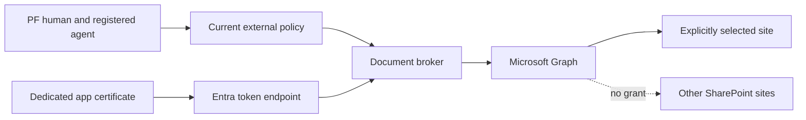
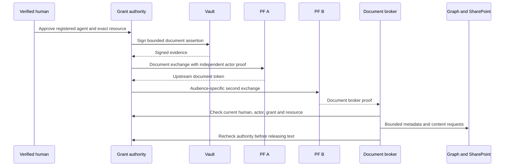

The external user can now authenticate with PF and invoke a delegated diagnostic through Copilot Studio. The next requirement is document access.

We did not solve that by provisioning external Entra users or sending PF access tokens to Microsoft Graph. Instead, a dedicated Entra application reads an approved SharePoint site. Our own policy independently decides whether the external human and registered agent may use that application capability for the current operation.

## Step 1: Establish a real site and entitlement

The project needed an actual SharePoint-backed Microsoft 365 environment. A trial was obtained through the tenant's supported process, and the owner created a dedicated PoC site.

Our examples use:

```text
https://exampletenant.sharepoint.com/sites/FederatedCopilotPoC
```

The real tenant and site identifiers are intentionally omitted. We also kept subscriptions, trial expiry and licensing separate from application authorization. A working Graph app cannot keep a tenant trial alive or purchase missing entitlements.

We used a small synthetic text file so that data handling and model answers could be checked without introducing sensitive business documents during the first live test.

## Step 2: Grant the broker only one selected site

We created a dedicated single-tenant application and service principal, requested the Microsoft Graph application permission `Sites.Selected`, and assigned a read-only grant on the exact approved site.



The selected permission and the resource assignment are separate setup steps. See [Microsoft's selected permissions overview](https://learn.microsoft.com/en-us/graph/permissions-selected-overview) for the underlying model. Our broker adds its own fixed-site and human/agent checks above that platform boundary.

The intended assignment shape is:

```json
{
  "roles": ["read"],
  "grantedToIdentities": [
    {
      "application": {
        "id": "<dedicated-broker-application-id>",
        "displayName": "copilot-m365-resource-broker"
      }
    }
  ]
}
```

This illustrates the selected-site permission payload. It is not a substitute for administrator consent, tenant verification or current Graph API requirements.

We did not add `Sites.Read.All`, `Files.Read.All` or tenant-wide full control to the runtime application.

## Step 3: Separate administrative setup from runtime

The administrator's setup client needed authority to inspect and assign site permissions. That is distinct from the broker's runtime access.

We reviewed that administrative authorization separately, verified the signed-in tenant, checked whether the grant already existed, and created only the approved read assignment when absent. The setup consent could persist and required its own lifecycle review. It was never copied into the broker's token acquisition path.

The repository's provisioning workflow prepares a plan before application:

```powershell
# Prepares the setup plan. Review it before any apply operation.
node --experimental-strip-types scripts/sharepoint/setup.ts
```

An apply operation requires the newly reviewed plan's own hash and the correct administrative identity. Historical hashes from another run must not be pasted into a new environment.

We retained durable receipts to prevent duplicate applications, repeated grants or blind retries after a lost response.

## Step 4: Enroll a certificate and keep Graph tokens server-side

The broker uses a dedicated certificate credential. The private key is held in a protected Vault KV record and read through a narrowly scoped, one-use credential reader. Only the public certificate is registered on the application.

This is server-side certificate custody. It is not a non-exportable Transit signer: the authorized broker process receives the private key in memory. That distinction matters for a production threat model.

The token request targets one approved tenant and the fixed Graph `.default` scope:

```text
POST https://login.microsoftonline.com/<approved-tenant>/oauth2/v2.0/token
Content-Type: application/x-www-form-urlencoded

grant_type=client_credentials
client_id=<dedicated-broker-application-id>
scope=https%3A%2F%2Fgraph.microsoft.com%2F.default
client_assertion_type=urn%3Aietf%3Aparams%3Aoauth%3Aclient-assertion-type%3Ajwt-bearer
client_assertion=<fresh-certificate-signed-assertion>
```

The implementation uses a fresh short-lived assertion, a unique identifier and the approved certificate thumbprint. Its PS256 and `x5t#S256` profile follows the [Microsoft certificate credential format](https://learn.microsoft.com/en-us/entra/identity-platform/certificate-credentials). Do not reuse the PF client's algorithm, assertion audience or key simply because both flows use signed JWTs.

The returned Graph token is an internal app credential. It does not identify the external human. We do not send it to the phone, a prompt or a Copilot tool input.

## Step 5: Prove transport before claiming federation

We first performed bounded app-level metadata and content checks against one uploaded file. That proved the certificate, selected-site permission and transport worked.

It did not prove that an external human or agent was authorized. Those early probes had no PF document grant. We explicitly kept their acceptance category at app-level transport and integrity.

This separation was useful when Graph returned metadata successfully but the reader stopped at a parent-site comparison. A successful HTTP status did not establish that every identity field matched our expectations.

Read-only diagnostics showed the returned parent site reference used the site's collection GUID representation. The original check expected a composite site identifier. We added exact handling for the observed representation and retained mandatory host, collection, web, drive and item bindings.

We also handled case normalization for GUID components without making arbitrary URL or host comparisons case-insensitive. A precise representation repair is safer than disabling a site check because one real response differs from a fixture.

## Step 6: Constrain metadata, content and redirects

For the initial file, the server pinned the site, drive, item, unique identifier, filename, size, MIME type and expected content hash. Metadata was checked before content access.

The read path validates the version and uses a version-bound content request. If Graph returns a preauthenticated SharePoint download URL, the reader permits only a constrained HTTPS destination on the approved site host with the expected download path and unique file ID.

It follows at most the reviewed redirect pattern, never forwards the Graph Authorization header to the download host and never exposes the signed download URL to the caller. Redirects are handled deliberately, not through an unrestricted `follow` setting.

This prevents a metadata response or compromised document from turning the broker into an arbitrary HTTP client. The same allowlist is applied before transmission and remains independent of model output.

## Step 7: Add a separate document grant and PF chain

The `copilot.invoke` capability is not document-read permission. We introduced dedicated document authority, PF processors and policies, client keys, audiences and resource consent for `m365.document.read`.



The real container verification was initially isolated from Microsoft reads. It exercised actual Vault and both PF domains, replay denial, expiry and revocation, then cleaned up the owned grant and temporary client activation.

PF clock skew and token lifetime granularity required care. We waited for actual token validity rather than weakening `nbf` checks. The tested mobile profile later uses distinct minute-based lifetimes across authority, PF A and PF B; downstream validity remains bounded by verified parent evidence.

## Step 8: Ground one actual Copilot answer

The first complete document question combined two independent chains:

1. The document chain authorized the approved file read.
2. A separate chat chain authorized the Copilot conversation.

The server read the 201-byte synthetic sample, checked its expected hash and supplied its bounded text as untrusted context. It created a new Direct Line conversation, used that conversation's fresh Generic OAuth card and sent one question.

The observed answer identified the approved research color as **teal**, the reference as **FEDERATED-COPILOT-POC-001**, and the source as `federated-copilot-poc.txt`.

Independent evidence confirmed both human and actor identity, distinct chat and document grants, current policy decisions, bounded Graph requests, the constrained content download and grant revocation before release. The system did not rely on the answer text alone as proof that authorization worked.

This was server-supplied context. It was not a native Copilot SharePoint connector, unrestricted tenant search or autonomous document access.

## Step 9: Reduce repeated browser logins carefully

The first workflow required separate fresh login evidence for several purposes. That was useful for isolation but cumbersome to demonstrate.

We prepared a narrower browser profile with brief PF session reuse, removed identity-only approval repetition and added a visible default-on resource approval choice. Opting out retained manual approval. We kept the separate chat and document grants, registered agent and revocation checks.

Fewer prompts did not mean one universal token. The browser session, resource consents, provider login token and delegated execution credentials remained distinct objects with different lifetimes.

## Step 10: Expand to bounded text discovery

The mobile work extends the server from a pinned sample to eligible documents within the already approved site. It enumerates that site's drives and folders under fixed limits rather than issuing unrestricted Graph search.

The current profile permits at most 16 UTF-8 `.txt` documents, 128 visited nodes, 64 discovery/read requests and 262,144 aggregate bytes. PDF, DOCX and scanned documents are unsupported. Unsupported files are counted and disclosed; they are not quietly described as readable.

Each eligible file still requires site/drive/item validation, MIME and size checks, current authorization and version consistency. Changed content invalidates existing context and requires a new chat. There is no cross-chat document cache presented as current authority.

The broader reader has local synthetic multi-document coverage. The live evidence described above remains one approved sample and one question. We have not promoted that result into live multi-document acceptance.

## Why this boundary matters

A broker app permission can outlive a person's current consent. A document can contain instructions that attempt to expand the task. A model can answer convincingly even when a test used mock content.

Separating Entra app access, external human/agent policy, constrained retrieval and independently checked evidence makes those failure modes observable. Part 6 takes the same separation to a fingerprint-unlocked Android chat application.
