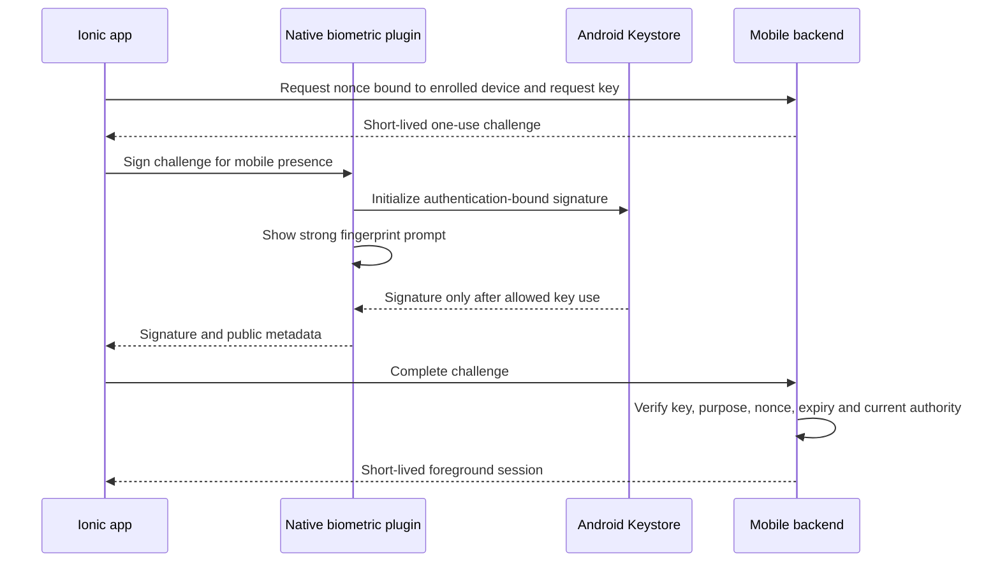
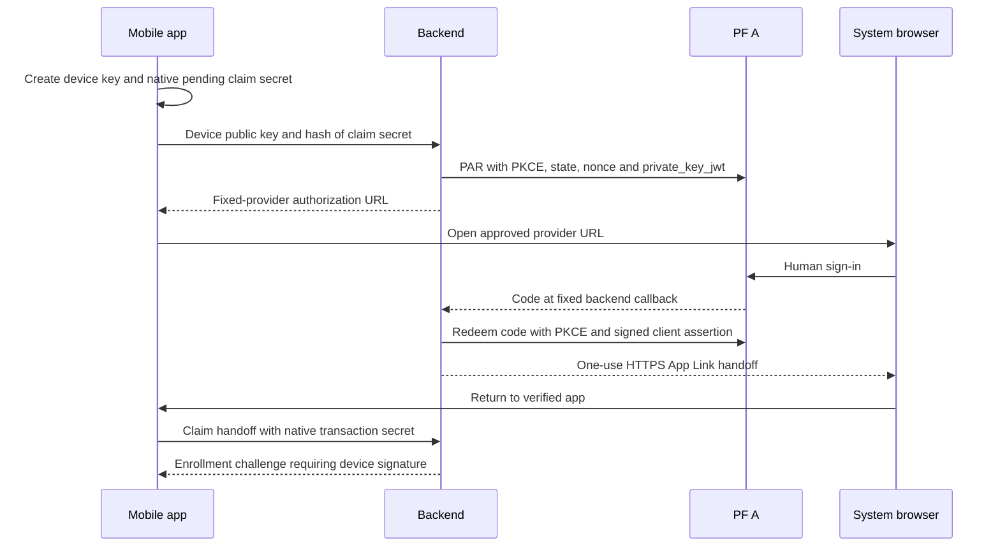
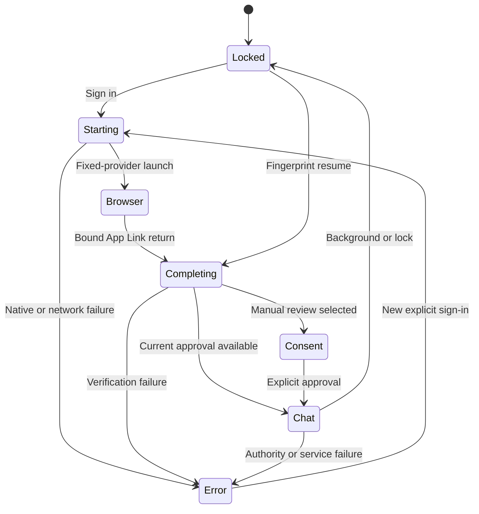

After the browser produced a verified document-backed answer, the next requirement was a phone application that could demonstrate the integration without repeated deployment windows and several logins.

The agreed target was Ionic React on a Pixel 6 Pro running Android 17, delivered directly as an APK. The owner wanted a remembered 30-day enrollment, fingerprint unlock, a new chat on every entry and access to supported documents inside the existing approved SharePoint site.

This article describes both the implemented design and its current verification boundary. The native device-test build passed owner-observed fingerprint and background-clearing checks. The live v5 APK is installed and distributed, and the backend is deployed. Live mobile sign-in is still under investigation: tapping Sign in has not yet been observed to redirect successfully to PF. There is no claim of completed mobile Copilot acceptance.

## Step 1: Separate the mobile project from the server

The Ionic application lives under `apps/mobile` with its own package and Android build. It does not add its UI dependencies to the dependency-light simulation.

```text
apps/mobile/
  src/                 React UI, controller and fixed HTTPS transport
  tests/               Lifecycle, transport and proof tests
  android/             Capacitor application and native plugins
  scripts/             Local Android build helper
src/mobile/            Server-side enrollment and execution components
```

There are two explicit build modes. The default is a labelled offline device test. The `live` mode uses the fixed agent API and never returns a local success message when real services fail.

```powershell
# Run from apps/mobile after installing its pinned dependencies.
npm test
$env:VITE_MOBILE_MODE = 'live'
npm run android:build
```

The repository helper checks the configured JDK and SDK, builds the web application, synchronizes Capacitor and runs native assembly, unit tests and lint. It signs with a dedicated local demo key outside source control. That key is a distribution credential, not a PF, Graph or agent credential.

## Step 2: Make fingerprint unlock cryptographic

A JavaScript flag such as `authenticated: true` is insufficient evidence for resuming a delegated session. We implemented a small native boundary that creates an authentication-bound P-256 Android Keystore key and signs a challenge through a strong biometric `CryptoObject` operation.



Android's [biometric cryptography guide](https://developer.android.com/identity/sign-in/biometric-auth) and [Keystore documentation](https://developer.android.com/privacy-and-security/keystore) explain the platform primitives. Our enrollment and server authorization protocol is additional application logic.

The native policy requires strong biometric authentication for key use, uses separate aliases and domains for local testing and live mobile presence, and checks reported hardware security level. It does not collect fingerprint images or templates.

The selected app policy has no device-PIN substitute for biometric session unlock. Fresh sign-in is the recovery direction, but the current enrollment path still checks that strong biometrics are available. Do not advertise a complete biometric-unavailable recovery experience until that case is designed and tested.

## Step 3: Preserve the hardware-attestation boundary

The phone can report that its key is backed by TEE or StrongBox and can produce a valid signature. Without verified remote attestation, the backend has not independently proved that every remote client enforces the same biometric policy.

We therefore label server evidence as registered-device-key possession with hardware attestation **UNVERIFIED**. The owner approved this explicit PoC assurance limit. A signature does not justify inventing a stronger assurance claim.

The APK contains no PF confidential-client secret, agent signing key, Graph key, Direct Line secret or Vault bootstrap credential. Its durable local state is limited to device-bound references and the consent preference. The native key stays in Android Keystore.

## Step 4: Keep first login in the system browser

We use backend-assisted PF login rather than embedding the provider page in the WebView. The backend owns the confidential client and provider tokens; the phone starts a device-bound transaction.



The handoff is short-lived, one-use and bound to the initiating device and claim hash. It is not a provider access token in a deep link. Process loss or missing native custody requires a fresh sign-in.

The return path is an HTTPS Android App Link. The association binds the exact hostname, package ID and APK signing certificate. A successful HTTPS GET of `assetlinks.json` does not prove Android has verified the association on the installed phone. That is a separate device check documented in [Android App Link verification](https://developer.android.com/training/app-links/verify-applinks).

## Step 5: Separate enrollment, foreground proof and delegation

The 30-day period is an absolute device enrollment ceiling. It does not make a PF access token valid for 30 days and does not move the original PF `auth_time` forward.

| Object | Purpose and bound |
|---|---|
| Device enrollment | Original verified human, device public key and absolute 30-day expiry |
| Resource consent | Separate chat/document grants, revocable and bounded by enrollment |
| Foreground session | Up to 15 minutes, replaced on fresh unlock |
| Request proof | At most 60 seconds, one use, exact method/path/body |
| Mobile authority assertion | Profile-specific short-lived issuance under current evidence |
| PF A and PF B tokens | Narrower audience-specific child evidence |
| Provider access/refresh session | Server-held Generic OAuth session, separate from delegated authority |

A foreground session ID alone grants no access. The app creates an ephemeral request key and signs a JWT binding session, configured audience, exact route, body hash, validity and unique `jti`.

The server consumes replay identifiers durably and rejects a proof for access status when it is reused for chat or approval. Extra identity, scope and resource fields are not accepted in the chat body.

Current device, human, actor, organisation, grant and resource checks run again during execution. A successful fingerprint cannot override a revoked grant or suspended agent.

## Step 6: Treat resumed interaction as its own evidence type

We did not reuse an expired OIDC login or switch the operation to autonomous mode to bypass recent-login checks.

The mobile authority preserves the original login issuer, subject, client audience and authentication time, and records current registered-device-key presence separately. It requires the current resource grant and an independently signed registered-agent assertion before issuing delegated evidence.

The original object returned by the trusted device authority is held in an instance-private registry. JSON copies cannot be reconstructed into authority. A future cross-process handoff would need authenticated transport and replay protection, not a serialized object accepted on trust.

Real Vault/PF container verification exercised the mobile chat and document chains with their own keys and clients. The current profile uses authority/PF A/PF B maximum lifetimes of 180, 120 and 60 seconds, while enforcing remaining parent validity. This is separate from the 60-minute provider user token used for Microsoft sign-in.

## Step 7: Design foreground lifecycle as a state machine



Backgrounding clears the current messages, cancels owned work and discards foreground signing authority. A legitimate system-browser departure preserves only its pending native login transaction.

Generation counters prevent late callbacks, duplicate App Link events and delayed network results from opening a chat after cancellation or crossing into a new session. A failed credential-bearing operation does not automatically replay.

Every successful entry or unlock starts an empty chat. Multiple questions are supported while that foreground session is active. The app and backend do not write a durable transcript or document cache. Microsoft-hosted conversations and traces have their own retention and are not deleted merely because the app clears its screen.

## Step 8: Separate default approval from identity

The visible default-on checkbox approves only the configured chat and document capabilities for the registered agent and existing site. It does not approve new sites, scopes or arbitrary model actions.

Turning it off requires manual resource approval. A revoked resource permission cannot be restored by a later automatic check under the same revoked binding. Unknown or unsaved preference state fails closed.

The device enrollment consent and resource delegation IDs remain different records. A phone that proves possession of its key is not automatically entitled to read documents.

## Step 9: Refresh provider credentials without creating a replay loop

The dedicated mobile login client requires PAR, S256 PKCE and signed client authentication, with authorization code and rotating refresh grants. Provider credentials remain in CAS-protected Vault records.

Before refresh, the old refresh credential is persisted as spent. An uncertain response requires fresh sign-in. Fresh access tokens are checked for issuer, audience, subject, signature and lifetime before release to the server-side Copilot adapter.

The provider must have enough remaining validity for the foreground chat. The deployment profile requires 960 seconds before opening a 900-second conversation, keeping a margin instead of starting a session with a nearly expired token.

Compatibility of this new private-key-authenticated provider client with the already published Copilot Generic OAuth configuration remains a live gate. Sharing issuer and audience is not proof of that compatibility.

## Step 10: Prepare persistent hosting without unlimited authority

The owner requested demos without 45-minute deployment windows or one-question limits. We introduced a separate persistent profile, preserving all spent historical allowances.

The approved standing ledger permits 100 attempted questions and 20 conversations, with additional fixed request ceilings. Counters persist across failures and restarts. This is a bounded operational allowance, not a currency meter or guaranteed enforcement of the existing $50 budget.

The private API binds only to loopback HTTPS. Exact Cloudflare routes expose the mobile API and App Link association; PF A gains only the reviewed PAR route. Workload certificate roles, durable usage, one-day audit retention and dependency supervision are separate from UI unlock.

An owned Windows startup task is prepared to run under the existing account without a stored password or operator Vault credential. It is intentionally not installed until owner phone acceptance succeeds. Docker, unsealed Vault, the host, network, Microsoft entitlements and certificate expiry remain real availability dependencies.

## Step 11: Record deployment findings accurately

Actual deployment exposed several mismatches that the local contracts did not catch:

1. PF rejected the new client because `offline_access` was absent from its global catalog. We obtained approval for that exact static scope addition and preserved every other setting.
2. PF serialized scopes in a different order. We verified exact set equality, retained pending history and reconciled the successful write without repeating it.
3. The new token manager could not publish a key ID already published by the original manager. We retained the approved signing key and disabled duplicate publication in the new manager.
4. The service manifest omitted an APK certificate field. We completed metadata from the already approved certificate and APK pin while preserving the original packet.

The private runtime became ready, the five mobile clients were enabled and public configuration and association endpoints returned HTTP 200. Those facts still do not establish phone sign-in.

## Step 12: Install, distribute and diagnose on the actual phone

The v5 candidate was installed in place using the same signing certificate. ADB inspection should target the owner's known device and must not automate fingerprint or password entry.

```powershell
adb devices -l
adb -s <owner-device> install -r <verified-apk-path>
adb -s <owner-device> shell pm verify-app-links --re-verify <package-id>
adb -s <owner-device> shell pm get-app-links <package-id>
```

When the owner moved off-network, we added an exact, time-limited APK download route through the existing public hostname. The server serves one hash-pinned artifact, refuses other paths and query variants, and does not expose a build directory. We downloaded the public artifact and verified its hash before sharing the link.

The current reported failure is that the app stays at its sign-in button. A bounded backend initiation check returned a valid authorization destination at PF A, so the next investigation is on the native client path. We initially suspected the offline page policy, then inspected the built artifact and confirmed live mode already replaced it correctly. That suspicion was withdrawn; no unsupported fix is claimed.

This is why the next acceptance test requires the actual phone: observe the preparing state, native key operations, pending login, browser launch and verified return without logging URLs, handoff secrets or credentials.

## Current outcome and production work

At the activation preparation checkpoint, 896 backend production tests, 372 simulation tests, 41 mobile tests and 12 native tests passed. Later isolated tests cover the scope amendment and APK route. These are historical checkpoint counts, not a claim that every subsequent change reran every suite.

The browser PoC has a verified document answer. Mobile core cryptography and lifecycle have local coverage, and the owner verified fingerprint behavior in the device-test build. Live mobile login, refresh, multi-turn document chat, Android association behavior and revoke/resume acceptance still need end-to-end verification.

Production work includes hardware-attestation policy, Microsoft trace protection, stronger workload isolation, rotation, reliable host recovery, billing enforcement, supported document formats and sustained availability testing. The useful result of this series is a set of explicit trust boundaries and measurable integration milestones, including the ones that remain open.
