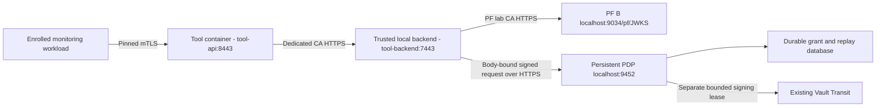

# Enrolled tool private Docker verification

Verified 2026-10-31 Australia/Sydney against the existing local Vault, PF B and dedicated persistent policy profile. **23 live checks pass** using the enrolled service credentials and selected immutable tool image. This is a controlled readiness/transport verification, not a continuously running deployment or a consent-backed tool operation.

`npm run tool:enrolled-network-test` previews the scope. `npm run tool:enrolled-network-test -- --run` executes it. It opens no host port, creates no grants, changes no PF client, contacts neither Microsoft nor Graph, and leaves no verification container, network or policy signing lease running.

## Fixed path and trust

The tool is attached only to the new internal Docker network (`10.236.250.16/28`). Docker rejects collisions; the runner does not remove or alter other networks. A separate backend container also attaches to the existing Docker bridge so it can reach the host's loopback services through Docker Desktop. The backend is a **trusted TLS terminator**. Its application routes only GET `/pf/JWKS` and signed POST `/v1/decisions` / `/v1/health`; it rejects administration, issuance, arbitrary paths and query overrides. This bridge arrangement is a local PoC transport boundary, not a production network egress firewall or an end-to-end opaque tunnel. The tool JWT/PDP request audiences and pinned signing keys remain independently validated.

Runtime trust stays fixed to issuer `https://pf-b.copilot.darkedges.com`, audience `api://copilot-tool`, RS256, kid `copilot-tool-signing`, and maximum token lifetime 120 seconds. The backend's PF JWKS can publish other public RSA/EC keys; the runtime still selects only the approved tool key/algorithm. Verification rejects private JWK material and requires the pinned RSA tool key.

## Credential and container boundaries

Before startup the runner authenticates with the Vault reader, checks the enrolled version and compares every selected snapshot value against the closed six-field record. It refuses a stale or altered selection. Operator access retrieves only the separate backend and monitoring records in memory, validates key/certificate correspondence and CA/name/pin agreement, and renders temporary role-specific mounts. It never renders the maintenance CA private key or gives Vault credentials to a container.

The tool receives exactly three mounts: selected runtime credentials and config read-only, and a dedicated verification audit directory writable. It receives no monitoring key, backend key, operator token, authority signing token or policy database. The monitoring probe and backend receive their own separate credential mounts. Containers run as UID/GID 1000, with read-only root filesystems, dropped capabilities, no-new-privileges, bounded memory/CPU/PIDs/logs and no published host ports. The tool image ID comes from the reviewed non-deploying artifact; mutable image tags are refused.

The custody root and its children retain the Windows current-account/SYSTEM restrictions. The runner uses an exclusive network-verification lock and the existing policy process lock. It removes only its owned containers/network and temporary backend/probe files. The selected credential snapshot and Vault records remain unchanged. Bounded audit evidence and a sanitized receipt stay under the protected run directory. Uncertain resource/credential/lease cleanup retains the lock for review; do not clear it merely to retry.

## Evidence and limits

The 23 checks cover:

- Selected snapshot/current Vault version agreement, startup with the persistent policy profile, signed readiness, liveness and actual public PF JWKS.
- Denial of backend administration/token/grant/assertion paths and query overrides, client-certificate absence, and missing/malformed delegated tokens.
- Non-root runtime, internal-only tool networking, no host ports and exact read-only credential/config versus writable audit mounts.
- Actual policy stop/restart and backend stop/restart: readiness fails and recovers while tool liveness stays available.
- Authenticated metrics and unchanged durable grant/consent counts.

All **253 baseline** and **283 production** tests pass. The verification completed at 2026-10-30 19:17:31 UTC (2026-10-31 06:17:31 AEDT), with its containers/network removed, temporary credential copies removed and policy signing lease retired. A first attempt failed because its public-JWKS assertion incorrectly required all published keys to be RSA; that assertion was corrected without changing runtime trust, and the failed attempt cleaned up its resources. No grant or authenticated tool operation was created to establish readiness.

The [real PF consent-backed canary](enrolled-tool-canary.md) now passes **47 combined live checks** through this enrolled path, including independent policy audit, human/agent continuity, real token expiry, renewal and revocation in both modes. It leaves grants revoked and services stopped. Continuous activation, operational owner/audit retention, production private routing/PKI, Copilot calling-workload authentication, Microsoft secure-token-post and Graph/SharePoint remain separate gates. Readiness alone does not establish any of those capabilities.
