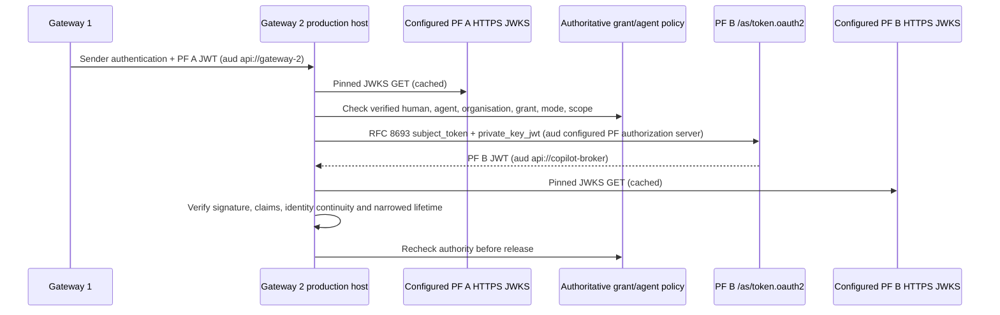

# Gateway 2 PingFederate exchange adapter

The library boundary is implemented and verified against two real local PingFederate 13.1.0 containers; see [container setup and evidence](pingfederate-containers.md). Production deployment and tenant approval remain **UNVERIFIED**. The checked-in HTTP services remain local simulations; this adapter alone is not a production deployment.

`src/adapters/token-exchange.ts` defines the interfaces and stable errors. `pingfederate.ts` implements verification and exchange with `jose`. `gateway-2.ts` selects an explicit mode without fallback. `pingfederate-env.ts` loads production configuration and a PKCS#8 client private key injected from a secret manager. No production path imports local keys or fixture grants.

Install the pinned optional production package with `npm ci --include=optional`, then run `npm run test:production`. Check the command succeeds: optional-package download failures must fail a production build when importing JOSE. `npm test`, `npm run keys`, `npm run dev` and `npm run smoke` remain dependency-free simulation commands. The production suite is separate so a package install is not required for the demo.

Configure these startup environment variables through deployment configuration/secret injection:

| Variable | Value |
|---|---|
| `GATEWAY2_EXCHANGE_MODE` | Exactly `production` |
| `PF_B_EXCHANGE_CONFIG` | JSON matching `PingFederateConfig`, example below |
| `PF_B_CLIENT_PRIVATE_KEY` | Secret-manager-injected PKCS#8 private PEM; never commit or log it |

The following values are reserved example domains, not real endpoints or credentials. Replace every issuer, endpoint, audience, namespace and key identifier with security-approved values. URLs must use HTTPS with no credentials, query or fragment. Configure TLS trust through your platform; never disable certificate verification.

```json
{
  "upstream": [{
    "issuer": "https://pf-a.example.com",
    "jwksUri": "https://pf-a.example.com/pf/JWKS",
    "audience": "api://gateway-2",
    "algorithms": ["RS256"],
    "keyIds": ["pf-a-current", "pf-a-next"],
    "organisations": ["partner-a"],
    "actorIssuers": ["https://pf-a.example.com"],
    "maxLifetimeSeconds": 180
  }],
  "downstream": {
    "issuer": "https://pf-b.example.com",
    "jwksUri": "https://pf-b.example.com/pf/JWKS",
    "audience": "api://copilot-broker",
    "algorithms": ["RS256"],
    "keyIds": ["pf-b-current", "pf-b-next"],
    "organisations": ["partner-a"],
    "actorIssuers": ["https://pf-a.example.com"],
    "maxLifetimeSeconds": 180
  },
  "tokenEndpoint": "https://pf-b.example.com/as/token.oauth2",
  "clientId": "gateway-2-token-exchange",
  "clientKeyId": "gateway-2-current",
  "clientAlgorithm": "RS256",
  "clientAssertionAudience": "https://pf-b.example.com",
  "targetParameter": "resource",
  "scope": "copilot.invoke",
  "timeoutMs": 5000
}
```

Production hosts call `gateway2FromEnvironment(authorise, observe)` or `createGateway2Exchange({mode: 'production', config, dependencies})`, then `exchange(verifiedTransportBearer)`. The library independently validates the bearer. `authorise(claims, {accessToken})` is required, has a bounded timeout, and must reject on missing authority, inactive/expired/revoked grant, suspended organisation/agent, or mismatch of issuer-qualified human, actor, organisation, mode and scope. The function returns `Promise<void>` on permission; it must throw on denial (do not return `false`). It runs twice, with the signed PF A and PF B tokens respectively. The [supplied authenticated policy client/service](delegation-policy.md) independently verifies that evidence against a persistent registry. Deployment still needs production policy hosting/approval, a sender-authenticated HTTP host, broker resource enforcement and audit operations; the demo host deliberately refuses `GATEWAY2_EXCHANGE_MODE=production`.



Each JWT needs a single exact audience, `iat`, `nbf`, `exp`, `jti`, human `sub`, `{sub, iss}` actor, `org_id`, `delegation_id`, execution mode and exact configured scope. Nested actor chains and additional actor fields are refused by this profile. Clock tolerance is five seconds, maximum configured lifetime is ten minutes, and PF B expiry must not exceed upstream expiry. Autonomous mode needs a fresh PF A token backed by independently validated grant authority; a grant ID alone cannot be exchanged.

JWKS cache lifetime is 60 seconds with a five-second fetch cooldown. Prepublish overlapping rotation keys and add their IDs to configuration before issuance. `kid` pins a permitted key identifier at an administrator-pinned HTTPS JWKS source; it is not a certificate/public-key fingerprint. Emergency key revocation requires restarting adapters/clearing their caches as well as issuer/policy revocation. No token-selected `jku`, `jwk`, `x5u` or `x5c` is accepted. Configure upstream issuer/organisation pairs separately to prevent cross-partner namespace confusion.

Client assertions use `typ=client-authentication+jwt`. `clientAssertionAudience` pins the HTTPS audience expected by the configured PF server; omission retains the full token-endpoint default. `targetParameter` chooses `resource` for PF ATM selection, or defaults to `audience` for existing integrations. Neither option is request controlled. The live PF profile requires the authorization-server base audience and resource selection; the access-token audience validators remain exact.

`requestedResource` may pin a distinct resource selector when `targetParameter="resource"`. The browser-consent profile uses unique URNs to select its ATMs independently of retained fixtures, while still verifying `api://copilot-broker` as the output JWT audience. This administrator-controlled value is never selected by request text and is not an arbitrary outbound URL.

Token POSTs are never retried; a fresh client assertion has a new `jti` on every invocation. JWKS network GET failures have at most one retry. Both use bounded network timeouts, refuse redirects and fail closed. Only stable `ExchangeError.code` values (`configuration`, `invalid_token`, `policy_denied`, `exchange_failed`) cross the adapter boundary. The optional observer emits credential-free outcome, code and duration. Map errors to generic host responses; never log request forms or remote error bodies. An injected fetch implementation is trusted infrastructure and must retain TLS verification, abort and redirect behavior; the normal production path uses native fetch.

## Live integration approval plan — UNVERIFIED

1. Register the Gateway 2 confidential PF B client with the client's public verification key. Verify assertion issuer/subject equal the client ID, audience equals the configured authorization-server audience, allowed algorithm/kid, expiry and unique `jti`. Prove wrong client, wrong key, expired assertion and assertion replay are rejected by PF B. These checks now pass in the local container profile; repeat with approved production configuration.
2. Configure PF B RFC 8693 processors to trust only approved PF A issuer/JWKS and `api://gateway-2`, preserving issuer-qualified human `sub`, original `act`, organisation, grant, mode and scope into `api://copilot-broker`. Verify the endpoint's subject/requested token types and response envelope match this profile. Refuse unexpected audience, wrong partner, absent actor, scope elevation and longer-lived issuance.
3. Run real interactive and grant-backed autonomous flows separately. Revoke/suspend the grant, human entitlement, organisation or agent before issuance and during issuance; both checks must deny. Confirm PF A independently validates autonomous proof and custody. Record maximum revocation propagation delay.
4. Rotate JWKS keys with overlap; test unknown IDs, removed keys after cache expiry, stale caches, endpoint failures, TLS certificate failures, redirects and timeouts. Exercise lost POST responses and confirm no automatic duplicate issuance.
5. Deploy only behind authenticated private ingress with independent Gateway 1 sender identity; prove broker checks active grant and approved resources on every operation. Connect the observer to credential-redacted audit/metrics and test key rotation from the secret manager.
6. Obtain security approval and record tenant/server versions and evidence. This task does not verify mTLS, discovery, PF A issuance, Copilot, Entra or Graph behavior.

Protocol references: [PingFederate token exchange](https://docs.pingidentity.com/pingfederate/12.2/introduction_to_pingfederate/pf_token_exchange_grant.html), [Ping Identity private-key JWT integration](https://github.com/pingidentity/hashicorp-vault-private-key-jwt-pingfederate), [JOSE remote JWKS](https://github.com/panva/jose/blob/main/docs/jwks/remote/interfaces/RemoteJWKSet.md).
