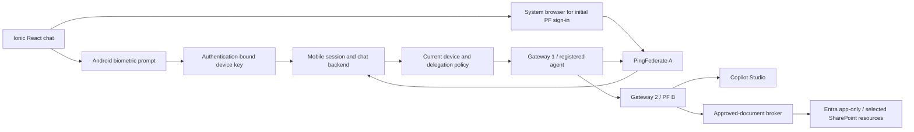

# Ionic React Android demo migration — agreed scope and delivery plan

Status: the installed v4 [device test](../apps/mobile/README.md) has owner-observed fingerprint/background fresh-chat success. The [backend enrollment foundation](mobile-device-authority.md), [API/App Link source](mobile-api-integration.md) and [native browser lifecycle/live-preview UI](mobile-browser-lifecycle.md) now pass local tests/builds. Public activation, authoritative resumed delegation, live mobile Copilot/document access and persistent hosting are not connected or deployed. New browser/custody/UI behavior remains UNVERIFIED on-device; the installed app is unchanged.

## Confirmed requirements

- **Ionic React with Capacitor**, initially Android.
- Target device: **Pixel 6 Pro running Android17**, as reported by the owner. Validate the native biometric implementation on this actual device, not just an emulator or browser.
- **Biometrics required for session unlock**. If unavailable, cancelled or locked out, offer a new PF sign-in; do not use device PIN/password as the app's unlock fallback.
- Open directly into chat after successful unlock, with the initial PF browser sign-in/enrollment handled when needed.
- Replace the temporary45-minute deployment and one-question restrictions with repeatable, multi-turn demos that do not require a fresh operator approval for each normal session.
- Support more explicitly approved SharePoint documents, not just the pinned201-byte sample.
- Remember the initial PF sign-in/device enrollment for **30 days**, with an absolute expiry rather than a sliding extension. Require biometric unlock on reopening; fresh PF sign-in remains the fallback for unavailable biometrics or rejected/expired enrollment.
- Initial document boundary: **all documents in the existing approved FederatedCopilotPoC site** (`https://nirvingukhotmail.sharepoint.com/sites/FederatedCopilotPoC`). This does not add another SharePoint site or tenant-wide read permission. Unsupported document formats remain visible as unsupported rather than silently parsed or used.
- Retain the default-on disclosed consent option, manual opt-out, independent human/agent identities and revocation.
- Start a **new chat on every app entry/unlock**, with multiple turns supported during that foreground chat. Do not restore prior conversations or save app/backend chat history. Microsoft conversation/trace retention remains separate.
- Use the **existing Windows/Docker infrastructure** and current public endpoint. No cloud migration or additional hosting subscription is planned.
- Install a signed APK on the owner's phone through **ADB**, with no Play Store distribution or additional testers in the first release.

## Decisions and remaining choices

| Decision | Status |
|---|---|
| Remembered PF sign-in/enrollment duration | Confirmed:30-day absolute device enrollment; tokens remain short-lived |
| First document boundary | Confirmed:all documents in the existing FederatedCopilotPoC site; no additional sites |
| Chat entry and app history | Confirmed:new chat each time; no saved app/backend history |
| Initial distribution | Confirmed:signed APK installed by ADB on the owner's phone only |
| Hosting | Confirmed:existing Windows/Docker infrastructure; supervise services and keep the host available |
| Retention | No saved app/backend chat history; existing one-day audit retention; Microsoft retention is separate |
| Usage budget | Retain the previously authorized $50 demo budget unless separately changed; implement usage monitoring before persistent activation |

## Proposed experience

First use: open app → PF sign-in in the system browser → review the default-on scope disclosure → enroll this device → return to chat.

Later use: open app → fingerprint prompt → start a new empty chat under the current authorized enrollment. When enrollment expires, the device is revoked, biometrics are unavailable or server resumption is rejected, return to PF sign-in. Backgrounding the app locks its UI and clears usable in-memory credentials; unlock does not extend the absolute enrollment/grant lifetime. Initial policy is to lock on background.

No biometric images/templates leave Android. The app's biometric policy does not remove Android's own requirement for a device screen lock or its OS-level recovery rules. On this device the target unlock method is fingerprint; do not assume arbitrary face unlock is sufficient for a cryptographic key.

## Architecture

Keep the existing gateway/PF/Vault/resource-broker boundaries. The mobile app is a human-facing client, not a holder of the registered remote agent's signing key. Human presence from the enrolled device does not establish acting-agent identity; the registered agent still authenticates separately at the backend.

### Native biometric session resumption

Generate an app/device-specific non-exportable Android Keystore signing key, gated by a suitable strong biometric through a cryptographic operation. A plugin that merely returns `authenticated=true` to JavaScript is insufficient. Prefer an existing maintained implementation only if its native code actually enforces key use; otherwise isolate a small reviewed Kotlin Capacitor plugin implementing that boundary. Biometric templates and key material stay outside JavaScript.

Enroll its public key only during a verified initial PF transaction. Bind the device record to the immutable external human, organisation, permitted agent, consent version and absolute enrollment expiry. Require a fresh server nonce and signed, purpose/audience-bound challenge for resumption; reject replay, other devices, revoked keys, changed identity, stale challenges and expired grants. A stolen session handle alone must not resume access. Enrollment-change/key invalidation behavior needs an explicit device test and fresh PF enrollment rather than silent downgrade.

**Biometric unlock is not PF token refresh.** Existing ID/access tokens retain their actual expiry and original authentication time. Introduce a distinct verified device-presence evidence type and policy path for resumed interactive operation under an active revocable grant. Preserve the original PF authentication provenance separately from current device-presence time. Do not synthesize a fresh OIDC `auth_time`, silently reuse the five-minute browser proof, or label the session autonomous merely to bypass interactive checks.

The backend issues fresh short-lived, audience-specific PF/gateway authorization after checking current device, human, agent and grant state. PF subject-assertion/processor support for this evidence is a separate integration milestone with negative tests and exact IAM review. Logout/device removal revokes resumption and active grants; biometric success cannot override a server-side revocation or service failure.

### OAuth and credential custody

Use an external system browser for PF authorization, retaining state, nonce and PKCE. Prefer a backend-assisted enrollment flow that keeps the current confidential PF client and provider credentials server-side. A one-use mobile handoff must be bound to the initiating device/transaction and redeemed over authenticated HTTPS; never put a reusable token into an app link. Choose verified Android HTTPS App Links for the return path and bind the app package to its signing-certificate fingerprint. If a separate native public OAuth client is needed, use PKCE without a client secret and review its exact callback separately.

The APK must contain no PF confidential-client secret, agent/gateway signing key, Vault bootstrap credential, Graph app key or Direct Line channel secret. Keep existing server-side Vault custody. Store only the minimum device-bound resumption metadata locally; avoid durable chat/document caches initially. A debug web implementation must not pretend to provide Android biometric/Keystore security.

Provider refresh and Direct Line renewal are separate from device resumption. The current provider client/profile and short conversation adapter are not a verified persistent-refresh implementation. Verify refresh eligibility, subject binding, rotation/revocation and new-conversation secure-card posting with the actual tenant. If fresh provider authorization is required, ask for PF sign-in; never fall back to a mock, expired credential or guessed SAS URL.

### Native chat and repeated turns

Create the mobile project under `apps/mobile` with its own dependencies/build settings; preserve the existing dependency-light simulation and production adapter tests. Build real Ionic chat components rather than embedding the existing portal as the whole app. Include unlock/sign-in recovery, a new empty conversation on entry, in-memory messages for the current foreground chat, pending/error states, source cards, revoke-device/sign-out controls and an access summary. Do not add a previous-conversation list or durable message history.

Replace the single-use `createDocumentChatTurn`/fixed-window runtime with a durable conversation service. Bind each conversation and every turn to verified human, agent, organisation and current authorization. Enforce ownership, monotonically recorded message/idempotency keys, bounded in-flight work and cancellation. Keep OAuth-card URLs and Direct Line credentials server-side. Do not claim true upstream token streaming until the actual Copilot channel supports it; an initial polling-backed chat UI is acceptable.

Separate the continuing consent/device session from per-turn authorization/read lifecycle. The current reader deliberately revokes its single-use document grant after one read; do not simply disable that cleanup or reuse a spent grant. Design an explicit parent-consent/per-turn issuance or equivalent reviewed lifecycle so every turn gets independently current short-lived proof and cleanup, and parent revocation invalidates later turns. Confirm context retention and revoke behavior in an actual multi-turn tenant session.

### No saved chat history

Keep message text and document excerpts in memory only while the current foreground conversation is active. On lock/exit, cancel owned work, prevent late results from appearing in a new chat, discard app/backend content and release the old conversation association. Persist only minimal device/authorization/idempotency metadata necessary for revocation and safe recovery, without message text. A backend crash/restart starts a new chat after unlock rather than reconstructing old messages. Exclude message bodies/excerpts from logs, analytics, crash reports and backups. Preserve the existing one-day audit policy for non-content records.

A new app chat does not imply that Copilot Studio deletes its hosted conversation or execution traces. Document actual Microsoft retention separately and expose no previous remote conversation through the app. Distinguish real app backgrounding from the expected system biometric prompt and initial OAuth browser handoff so setup can complete without restoring any prior chat.

### Approved document catalog and retrieval

Retain the Entra app-only broker and approved resource boundary. The owner selected all documents in the already approved FederatedCopilotPoC site. Additional sites remain out of scope. Existing `Sites.Selected` permission is not permission for the app to choose arbitrary sites, nor does app permission replace external human/agent policy.

Replace the single hard-coded sample alias/hash with an administrator-managed catalog of approved site/drive/item IDs, eligibility, versions/ETags, content types, size limits and human/agent entitlements. Use the confirmed whole-site boundary for discovery and indexing; do not require a new manual per-file approval for every document added inside that approved site. Independently validate each discovered item against the pinned site/drive relationship and current eligibility before processing. User questions and model output must never select Graph hosts/URLs or grant new resources.

Add bounded retrieval over eligible documents, with source attribution, version checks and current authorization before read and release. Treat retrieved text as data, constrain total excerpts/context, and keep retrieval incapable of following embedded instructions or links. Begin with text and explicitly supported document formats; determine PDF/DOCX parsing and scanned-document requirements before adding them. Any index or cache must respect removal, revocation and content updates.

Source cards should be viewable through an authorized broker route when appropriate. Do not assume PF-only users can open normal SharePoint URLs, which may require an Entra user identity; do not expose raw Graph access tokens or signed download URLs to solve that.

### Availability without disposable demo windows

Retire per-deployment45-minute and one-question test counters only through a new persistent demo profile. Preserve all historical spent packets; do not reset or repurpose their journals. New persistent conversation/device/grant stores need their own schema, retention and recovery rules. Normal sessions should operate under an owner-approved ongoing demo policy, not require repeated manual approval of ordinary calls.

Use the confirmed existing Windows/Docker host and Cloudflare endpoint. The host must remain powered on and awake for online demonstrations; an unavailable host produces a clear reconnect/sign-in state, never simulated success. Plan supervised startup/recovery after reboot, durable storage, TLS/certificate/key rotation, scoped Vault workload authentication, explicit seal/unseal recovery, liveness/readiness and failure reporting. The current one-hour operator-minted policy lease is not an always-on credential strategy: migrate it to narrowly authorized workload retrieval/signing without unattended operator/root access. PF, Microsoft licensing/trials and credential expiry remain dependencies that need monitoring.

Retain ordinary rate/concurrency controls, bounded request retries, current grant/token validation, audit minimization/one-day audit retention and resource restrictions. Removing disposable demo timers does not require never-expiring bearer tokens, unrestricted Graph permissions or unbounded spending. Persistent IAM, startup/task/service installation, public API/App Link routes and billing changes each need concrete deployment scope before application; this document does not execute them.

## Delivery stages and acceptance

1. **Native shell and biometric spike — APK built, physical verification pending.** Ionic React/Capacitor Android app and native per-use fingerprint-protected signing key compile and pass local checks. The first build has an unmistakable local-device-test chat and no backend calls. System-browser/App Link enrollment return is deferred to stage2; it is not simulated as a successful login. Test cancel, lockout, no enrollment, background/OS restart and changed enrollment on the actual Pixel before claiming hardware acceptance. Pinned toolchain/dependencies and APK details are in apps/mobile/README.md.
2. **Mobile enrollment and resumption.** Backend-owned initial PF/provider flow, durable device registry, revocable resumption, explicit resumed-interactive evidence and actual PF A/B issuance. Prove cross-device/user replay denial, server revocation, expired enrollment, lost handoff and no credential release before the native key operation. No Graph read required to prove this boundary.
3. **Repeatable real chat.** Owned multi-turn conversations, Direct Line/provider lifecycle and user-open→fingerprint→new chat. Test initial and biometrically resumed app launches with a new conversation each time, revoked sessions, expired provider/channel credentials, concurrent messages and interrupted responses. Prove that background/exit discards app/backend message content and prevents late responses from crossing into the next chat. Do not infer acceptance from the earlier single-turn result.
4. **Multi-document grounding.** Approved catalog/retrieval, multiple source citations and bounded parsing. Demonstrate correct answers across at least two owner-approved files and rejection of a document outside the approved site, unsupported/stale/deleted content and injected authorization instructions.
5. **Persistent demo hosting and ADB installation.** Supervised existing-host deployment, restart/credential recovery, availability/usage monitoring,30-day device enrollment, no durable app/backend chat history and a signed APK installed through ADB on the owner's Pixel. Rehearse from a restarted host and reopened phone app; confirm no per-test operator approval is needed within the agreed ongoing demo policy.

The quickest useful milestone is stages1–3 against the already verified sample; stage4 expands documents afterward. Implementation should not bundle mobile biometrics, a new trust evidence type, broad retrieval and permanent hosting into one unreviewable change. This is sequencing, not a request to repeat approval for every normal demo turn.

For ADB delivery, use a stable demo package ID and a dedicated signing key held outside git. Bind verified App Links to that package/certificate, document the local build/install/update procedure and test updates/reinstallation on the actual Pixel. No Play account or distribution workflow is part of this first-release plan. Do not connect to or install on the phone merely to prepare this document.

## Tooling and primary references

Use the maintained Ionic Framework/Capacitor core and test Android17 compatibility directly. Do not select Ionic Identity Vault/Auth Connect as a new long-term dependency without an explicit migration decision: Ionic announced its commercial products' end of life for31 December2027; the open-source core is unaffected. Commercial native-vault alternatives or a small native plugin remain options, pending cost/support evaluation; no subscription is approved by this plan. [Ionic commercial-product transition](https://ionic.io/blog/%F0%9F%9A%80-announcing-a-partnership-with-capawesome).

- [Android biometric cryptographic authentication](https://developer.android.com/identity/sign-in/biometric-auth) and [Keystore](https://developer.android.com/privacy-and-security/keystore).
- [Native OAuth external-browser and PKCE requirements, RFC8252](https://datatracker.ietf.org/doc/html/rfc8252).
- [Verified Android App Links](https://developer.android.com/training/app-links/about).
- [Android17 behavior changes](https://developer.android.com/about/versions/17/behavior-changes-17). Use the public HTTPS backend; no assumption that the phone's localhost is the Docker host.
- [Capacitor environment/toolchain setup](https://capacitorjs.com/docs/getting-started/environment-setup). Final versions are pinned after the device spike, not inferred from preview documentation.
- [Microsoft selected-resource permission model](https://learn.microsoft.com/en-us/graph/permissions-selected-overview). Additional selected resource grants require explicit scope; no tenant-wide app-read permission is proposed.
