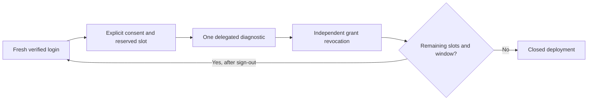

# Repeatable interactive diagnostic sessions

Status: **implemented locally; live deployment and multi-session tenant acceptance UNVERIFIED**. The earlier single-check browser PoC remains verified. Its finished journals and approvals are preserved.

Repeatable mode is a separate, explicitly reviewed deployment profile. The existing single-check profile remains the default. Each session requires fresh PF human login, explicit agent consent, same-human provider sign-in and one fixed delegated access check. After a check, **Sign out and start again** revokes any remaining owned permission and clears the browser session before a new login. There is no automatic consent, retry, token reuse, chat or Graph access.

## Limits and state

The proposed first live profile permits **five sessions in a fixed one-hour window, one active session at a time**. Each consent attempt spends one slot before the remote approval call, even if it ends without a Microsoft request. Each slot permits at most one conversation, one fresh-card token POST and one successful diagnostic. Source bounds allow only2–25 slots with serial execution; the actual reviewed cap is fixed in both approval and the durable deployment row. Changing a cap or review cannot reset an existing ledger.

Repeatable state uses `sessions.<approved-run-id>.sqlite`, never an existing one-shot ledger. The deployment review, first-start window, used proof hashes, per-session counters and recovery obligations survive process restarts. Existing spent predecessor journal/window/result hashes are verified. Staging has a separate journal and no execution authority. Browser data cannot select a run, approve a budget, change identity/scope/resource or reset counters.



Completion or failure does not free a slot for reuse. A new slot becomes available only after the earlier owned grant is independently confirmed revoked and its recovery intent completed. An unconfirmed consent response blocks all new sessions while ownership is unresolved, including when a delayed commit is not yet visible. This can require operator recovery; no missing response is treated as proof that no grant exists.

## Identity and lifecycle

Original verified human issuer/subject/audience, registered actor/issuer, organisation, grant, interactive mode, fixed resource and token audiences remain checked by the existing PF, policy, handoff and tool boundaries. Every new slot requires a new ID-token proof; an earlier proof hash cannot approve another slot. The control plane remains separate from the credential-free web worker.

Human proof freshness and the session recovery deadline remain at most five minutes; the one-hour deployment window does not refresh either. Expired sessions cannot execute. Restarted controllers cannot resume in-flight proof ownership; explicit recovery revokes abandoned grants before remaining capacity is usable. Serial SQLite reservations apply across controllers, not just one browser's memory.

The dedicated PF tool client remains enabled under the reviewed ownership lease while the bounded repeatable window has capacity. It is restored disabled after the final recovered session, window expiry, shutdown/failure or owned recovery. It does not grant access without an independently active grant, agent proof and current authorization.

## Maintenance

Existing one-day audit settings remain. Recovered session proof/grant metadata is cleared after one day, while minimal spent rows/counters remain to prevent budget reset. Pending recovery evidence is retained until resolved. Active maintenance uses the existing sweep; stopped maintenance is available through:

```powershell
node scripts/vault/maintain-portal-sessions.mjs --verify
node scripts/vault/maintain-portal-sessions.mjs --apply
```

The command requires the selected Windows owner, one-day retention and a stopped portal. It scans only repeatable session ledgers, defaults to preview and cannot renew/reset a deployment or delete pending ownership. No offline scheduler is installed; an offline host retains eligible metadata until maintenance runs. Historical single-check ledgers are untouched.

## Live verification plan

After approving the exact deployment packet, verify hashes, prior cleanup, ready dependencies, current public HTTPS/denied paths and read-only Microsoft connection/publication state. Start a new bounded profile without overwriting earlier budgets. Complete two owner-operated sessions, signing out and signing in again between them. Require distinct grants and proof hashes, one measured conversation/POST/check per session, two matching independent tool-policy permits per grant, origin success and confirmed grant revocation after each.

Verify remaining capacity, then explicitly revoke/sign out an approved unused session and confirm that it spends a slot without a successful tool operation. Any additional lifecycle probe must fit the approved remaining cap; never retry a spent session. Stop at an unexpected result. Local tests do not establish multi-session tenant acceptance.

Graph/SharePoint, autonomous SSO, Microsoft expiry/revocation scenarios, production OS isolation and Microsoft tool credential-trace protection remain outside this verified feature. The existing PoC trace exception does not establish production protection.

## Deployment outcome - 2 November 2026

The approved five-session profile and exact key-only amendment are deployed. The fixed window is16:58–17:58AEDT today. Initial ledger/public/connection readiness checks passed with0/5 sessions used and earlier spent runs unchanged. Multi-session tenant acceptance remains UNVERIFIED until two owner-operated fresh sessions are independently confirmed. The immutable review and approval receipts remain separate from this outcome.

## Two live sessions verified - 2 November 2026

Repeatable interactive browser diagnostic acceptance is now VERIFIED_POC. Two owner-operated sessions used distinct verified proof hashes and distinct grants; each completed1 conversation,1 tokenPOST and1 successful diagnostic, with exactly2 matching independent tool-policy permits and confirmed owned-grant revocation/recovery. Two origin200 responses and unchanged predecessor hashes corroborate the result.3 of5 slots remain until17:58AEDT in the same window; no renewal is authorized. See the non-secret repeatable-two-session-success.json receipt. This outcome supersedes only earlier multi-session UNVERIFIED labels; production, autonomous and Graph limitations remain.

## Live revocation before check - 2 November 2026

Session4 was explicitly revoked before the check. Its grant is independently revoked/recovered with0 conversations,0 tokenPOSTs and0 tool permits/operations. This is live confirmation of revoke-before-execution cleanup and no effects; a stale-credential invocation after revocation was not run. The ledger records3 prior successful checks and this revoked slot, leaving1 slot until17:58AEDT. Do not infer a second remaining lifecycle slot or reset the budget.

## Final expiry probe - 2 November 2026

A separately approved one-shot run804f3d56-3c88-452f-9534-871ec155b9b5 followed the spent five-session deployment. Owner left the ready page untouched and reports the generic rejection after the instructed waiting period. Independent confirmation at17:36:55AEDT found the17:32:54 recovery deadline passed, owned grant revoked/recovered, zero conversations, zero tokenPOSTs, zero successful tools and zero independent tool permits. PF tool client disabled, lease removed and new sign-in disabled. Previous five-session evidence unchanged. Browser-session expiry plus cleanup is VERIFIED_POC; request timestamp was not directly measured and the response does not distinguish expired browser state from concurrent grant revocation. Isolated PF-token and Microsoft expiry behavior remain unverified. The final allowance is spent, with no automatic retry or renewal.
