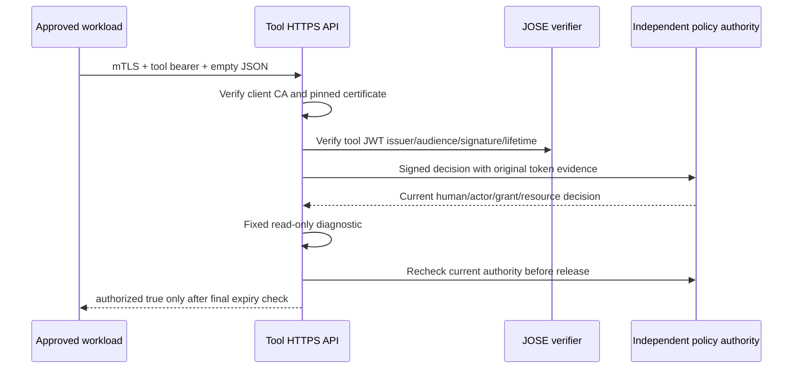

# Protected tool API — local implementation

Implemented 2026-10-30. This is a factory and a read-only authorization diagnostic, not a deployed public endpoint or a verified Copilot-originated call. Generic OAuth token-post acceptance remains **UNVERIFIED**. Graph/SharePoint remain disconnected.

## Fixed contract

`POST /v1/tools/verify-access` accepts exactly an empty JSON object (`{}`), `Content-Type: application/json`, and one `Authorization: Bearer …` header containing a tool-audience access token. The request cannot select a human, agent, grant, organisation, execution mode, scope, resource, URL, operation or prompt. Query strings and alternative paths are rejected.

The only success response is `200 {"authorized":true}`. It means the configured diagnostic's local token/policy checks passed, not that Microsoft accepted SSO or that any document was read. Arbitrary callback output and identity claims are not serialized. Responses disable caching. Error bodies contain fixed codes only:

| Status | Meaning |
|---|---|
| 400 | Invalid route, JSON or media type |
| 401 | Missing, duplicate or invalid delegated bearer credential |
| 403 | Unapproved workload certificate or denied current grant/policy |
| 413 | Request body exceeds 1 KiB |
| 503 | Tool failure, timeout or unavailable dependency; no protected result released |

A missing/untrusted client certificate fails the TLS handshake before an HTTP response. Certificate pinning rejects a certificate that chains to the trusted CA but is absent from the explicit workload allowlist.

## Composition and independent authorities

`src/copilot/tool-api.ts` requires an explicitly composed `PolicyProtectedTool`. Its verifier must be the hardened `JwksTokenVerifier` with approved issuer/JWKS, algorithm, key IDs, organisation, actor issuer, lifetime, audience and scope. Its authorization dependency must be the independent authenticated online PDP. The existing `localToolAuthority(...).tool(...)` provides this composition for the isolated PF lab; it does not launch an HTTP service.

The lab's tool JWT issuer is `https://pf-b.copilot.darkedges.com`, audience `api://copilot-tool`, scope `copilot.invoke`, maximum lifetime 120 seconds. JWKS transport is fixed verified HTTPS `https://localhost:9034/pf/JWKS`. The policy capability remains server-pinned to `sharepoint:approved-research`; the diagnostic makes no SharePoint request. These are the existing explicit lab trust settings, not production defaults.

`src/copilot/tool-server.ts` creates an HTTPS server with mandatory client certificate validation and a required list of uppercase colon-separated SHA-256 certificate fingerprints. It requires server key/certificate and an explicit client CA. TLS validation options cannot disable client certificate enforcement. The application reads workload identity from the verified TLS socket, never a forwarded certificate or identity header. Secrets/certificates are supplied by the composition root from protected custody, not request data.

The factory never calls `listen`, creates a route, generates a credential, selects mock mode, or contacts Microsoft. Tests bind ephemeral listeners only on `127.0.0.1` and close them. No persistent tool listener was installed. Operation and policy deadlines, cancellation, sanitized telemetry and before/after authorization are inherited from `PolicyProtectedTool`. POST operations are not retried automatically.

## Verification

Run `npm run test:production`. The loopback HTTPS tests require OpenSSL on PATH to generate disposable test certificates; they never load PF/operator certificates and remove their temporary files. The dependency-free demo and baseline tests do not require OpenSSL.

Initial API milestone: all 262 production and 169 baseline tests passed. New tests cover both modes with signed JOSE tokens and independent signed policy requests, original identity continuity, wrong-audience denial, grant revocation, malformed/oversized/authority-bearing requests, missing or unapproved client certificates, duplicate Authorization, safe response projection and sanitized errors. Existing tool-authority tests cover signature/claim substitution, suspension, expiry during an operation, policy outages and revocation during result generation.

## Actual local integration verification

### Actual PF-to-tool HTTPS verification

`npm run tool:http-test` previews the local harness. `npm run tool:http-test -- --run` executes it against the prepared PF pair and selected Vault signer. Requires OpenSSL on PATH, a valid Vault runtime lease, current local consent OIDC key pins, and free consent-test port 9461. Refresh an expired local lease using `npm run vault:setup`; the harness itself fails closed without a usable selected signer.

The runner uses a fresh isolated SQLite registry and HTTPS policy process, temporarily enables only PF B's existing tool-exchange client, and preserves PF A's enabled human-login client. A shared exclusive lease prevents overlap with live SSO/client-verification runs. HTTPS tool listeners bind ephemeral ports on `127.0.0.1`; no listener remains after cleanup. No Microsoft channel configuration/secret/budget is read or used. No Microsoft/Graph request or public route is part of this harness.

Initial actual-container milestone on 2026-10-30: **16 checks passed**. Each of interactive and autonomous execution proves actual PF tool-token acceptance over mTLS, denial of an unapproved TLS-valid workload certificate, missing certificate, resource/human override, invalid token, upstream PF A token substitution and revoked grant. Additional checks prove revocation during the operation suppresses the result and stopping a separate actual policy process denies further HTTPS tool execution. The policy-outage check first succeeds under the same active grant/token before stopping the service, so it cannot pass merely because a grant was already revoked.

The parent independently reads consent-backed grant state and PF client states after the worker exits. The final receipt confirms all grants revoked, A enabled/B disabled and disposable certificate files removed. Incomplete cleanup preserves the exclusive lease and reports recovery required. Receipts contain fixed check labels and statuses only, not tokens, login material, certificate keys or HTTP bodies. All **171 baseline and 262 production tests pass** after this milestone.

During development the lifecycle guard incorrectly treated PF's randomized `clientAuth.encryptedSecret` ciphertext as configuration drift; two successive credential-safe reads reproduced that one changing field. Added failing-first regression coverage and excluded only that non-comparable ciphertext from configuration comparison. Every other observable field is still compared, and A is never written. This cannot independently prove an out-of-band secret rotation did not occur; it does not relax runtime token, TLS, issuer, audience, policy or credential checks.

Expanded verification on 2026-10-30: **27 actual-container checks pass**, including real-clock token expiry and restart-based workload certificate rollover. Interactive and autonomous tokens first succeed over HTTPS, age naturally past their verified expiration while their grants remain active, then receive HTTP 401 without executing the operation. Fresh PF tokens under those exact same active grants succeed. No fake clock, lifetime relaxation or grant revocation substitutes for token expiry in this check. The expanded harness takes approximately two minutes; its worker has a 180-second deadline.

Certificate rollover uses the same loopback endpoint and unchanged server certificate, drains/closes the previous listener and creates a new listener with a reviewed trust snapshot. During overlap, both old and successor workload certificates succeed. After retirement the old certificate receives HTTP 403 without operation execution, while the successor succeeds. Restoring the isolated test profile removes successor access again. The offline HTTPS test also proves that mutating the input pin array cannot change a running server's trust snapshot. The implementation exposes no HTTP trust-update route and does not mutate production trust.

Final regressions: **171 baseline and 263 production tests pass**. Parent cleanup confirms all test grants revoked, A enabled/B disabled and all disposable key/certificate files removed. No Microsoft or Graph requests occurred. TLS/issuer/audience/expiry checks and the existing token lifetimes are unchanged.

**UNVERIFIED:** live hot replacement of client trust without restarting/draining a listener, CRL/OCSP revocation, server-certificate rollover/expiry, distributed hosting, production sender identity and Copilot-originated delivery. This is certificate-pin retirement at the application boundary, not a claim of certificate-authority revocation or production continuity during rotation.

### Remaining deployment and tenant checks

The [deployment review package](tool-api-deployment-review.md) now records these choices and gaps in a non-secret, non-deploying draft. Run `npm run tool:deployment-review` for offline draft checks; this is not runtime configuration or authorization to deploy.

1. Obtain Microsoft service-side tracing for the failed secure token-post flow before claiming Generic OAuth acceptance. No further conversation is implied by this API milestone.
2. Select and approve the actual tool-calling workload and its separate credentials. Direct Copilot HTTP-action support for client certificates has not been established here. A gateway can be the authenticated workload only when its own inbound caller verification is separately implemented and reviewed; unverified headers must not stand in for that verification.
3. Review an exact HTTPS deployment, private connectivity, certificate custody/rotation, rate limits and audit retention. No public ingress or tenant policy changes are included in this milestone.
4. Prove that a real Copilot-originated invocation carries the exact separately audienced token in a protected header, with no prompt/transcript/token logging. Independently verify the received identity and policy, then exercise expiry/revocation, wrong audience, unapproved resource, sender substitution and policy outage in the live environment.
5. Add document operations only behind their separate reviewed resource-scoped Entra application and approved site policy. A successful diagnostic does not authorize Graph permissions or arbitrary resource selection.
