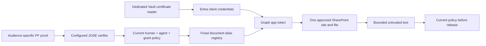

# SharePoint document adapter

Status,2 November2026: local factories tested; dedicated Vault certificate custody/public registration VERIFIED_POC_CUSTODY. Live broker token/document acceptance remains UNVERIFIED and is not attached to the portal. Existing SharePoint Sites.Selected/read-site setup is verified. No real document has been read by this implementation.

Entra authenticates the broker app, never the external PF human. Graph does not apply the PF human's personal SharePoint ACL. Independent policy must authorize that human, actor, organisation, grant, mode and capability. App tokens never enter a prompt, browser or tool input. Returned proof provenance preserves the verified proof issuer/audience and original sub/act/org/grant/mode/scope without rewriting identities.

src/m365/graph-documents.ts accepts only a configured proofAudience, a trusted TokenVerifier, an authoritative online authorise dependency and a separate GraphAppTokenSource. The controller maps fixed document aliases to approved resource/site/drive/item/unique IDs. It must use an audience-specific verifier and independently configured policy client for m365.document.read plus each exact resource. This is not an HTTP API and cannot treat a caller-supplied claims object/header as authority. Existing copilot.invoke proof/grants are not reused as document authority. No policy/PF runtime scope was changed in this milestone.

Each read checks policy before app-token acquisition, each Graph request, a possible constrained credential-free download, and final release. It verifies metadata site collection/web/unique ID, drive/item, exact filename, version eTag and size. Only .txt,text/plain, valid UTF8 with a configured1–65536-byte limit is supported initially. No search/listing/pagination, writes, model-selected URLs, PDF/Office parsing or automatic retry. Wrong MIME/length/identity/resource, service failure and expiration fail closed. Metadata is bounded16KiB and the overall adapter operation has a fixed deadline. Counters/observer events include only outcome/bytes/duration and fixed error text.

Graph /content may return302 to a preauthenticated SharePoint URL. Only one same-site-host /_layouts/15/download.aspx or site-relative equivalent is permitted, with exactly one UniqueId matching the pinned file. HTTPS, no credentials/fragment, no second redirect and no Authorization forwarding are mandatory. The signed URL/query is never returned or logged. Actual tenant redirect/metadata behavior remains a live verification gate; do not broaden these rules merely because a mock passes.

src/m365/entra-certificate.ts validates the exact dedicated Vault record/public SHA256 pin, uses JOSE PS256 and x5t#S256 with a fresh60-second JTI assertion, and posts once to https://login.microsoftonline.com/{approved-tenant}/oauth2/v2.0/token for https://graph.microsoft.com/.default. Tokens remain opaque internal app credentials; their externally returned OAuth expiry is bounded and never used to identify a human. Every read still needs independently current external authorization. No token/credential fallback or transparent401 retry.

src/m365/vault-credential.mjs admits only version1 of the new exact record through its dedicated one-use120-second reader. Enrollment and public-key registration are separately reviewed in sharepoint-credential-custody-review.md. The approved credential is now enrolled and its public certificate registered, with actual denial/idempotence evidence in .local/sharepoint/credential-enrollment-completed.json. No broker token or document request has occurred. The PoC KV key is exportable to the trusted controller; this is not a non-exportable production signer.

## Remaining live plan

1. Apply only the approved credential/certificate packet and verify Vault denial/idempotence plus public certificate readback without requesting a token or reading data.
2. Prepare one synthetic .txt sample, immutable item/drive/unique-ID registry and a separately reviewed m365.document.read policy/PF audience profile. Do not accept a prompt-selected item or site.
3. Review a bounded client-credentials and synthetic document read test, including negative policy/resource/credential/timeout/revocation scenarios. Existing Copilot allowances remain spent.
4. Only after live evidence, prepare the portal/Copilot document tool with appropriate data handling and its own explicit scope/publication/test review. No document content in audit/telemetry; preserve the one-day audit policy. Document text remains untrusted input to any later model.

Official protocol references:
- https://learn.microsoft.com/en-us/entra/identity-platform/certificate-credentials
- https://learn.microsoft.com/en-us/graph/api/driveitem-get-content?view=graph-rest-1.0
- https://learn.microsoft.com/en-us/graph/permissions-selected-overview

## Actual metadata acceptance - 2 November 2026

One explicitly approved operator probe passed with actual Vault-backed certificate client authentication, one Entra broker token acquisition and two exact Graph metadata responses for the site and uploaded sample. Immutable drive/item/unique IDs are now known in the local candidate registry. The probe downloaded no content and supplied no PF human/actor proof; it proves app-level metadata access only. Its one-shot allowance is spent. Sample content hash, document read and the federated policy/portal data flow remain UNVERIFIED pending separately scoped work.

## Live transport outcome - 3 November 2026

The measured collection-GUID correction now passes actual tenant metadata and a single approved sample-content read.201 downloaded bytes match the expected synthetic SHA256 after two Graph GETs and one constrained SharePoint download, using one Vault-backed broker token acquisition. No file text/token/signed URL was persisted; all predecessor hashes remain unchanged. Operator transport/integrity is verified, and this allowance is spent. Real PF human/agent document authorization, document policy/proof issuance and portal/Copilot publication remain UNVERIFIED; no operator allowance is a substitute for that authority.
