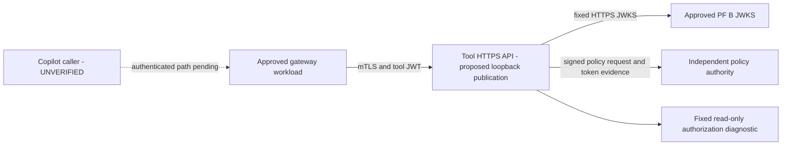

# Tool API deployment and operations review

Prepared 2026-10-30 (Australia/Sydney). **DRAFT / NOT DEPLOYABLE.** This package proposes the next deployment shape; it creates no container, port, DNS/tunnel route, certificate, cloud resource, tenant setting, permission or billable service. The Microsoft token-post HTTP 400 remains unresolved, and Graph/SharePoint remain disconnected.

## Proposed first placement

The operator selected the existing Docker setup. Use an isolated non-root Linux container on the existing Windows/Docker PoC host. Publish container HTTPS 8443 only to `127.0.0.1:9480`. This permits an approved local gateway/diagnostic workload to call it; it does not make the API available to Copilot Studio. Keep PF administration, Vault operator material and host project directories outside the container. The first PoC host and runtime entrypoint are selected; a local image ID is recorded in the draft. Local Vault custody is selected and verified; registry promotion and actual runtime credential enrollment remain unresolved.

The process must compose `JwksTokenVerifier`, `PolicyClient`, `PolicyProtectedTool`, `ToolApi` and `createToolServer` explicitly. The secure composition root and image build are now implemented; see the [Docker runtime](tool-docker-runtime.md). Compose has been validated but not started; a production deployment launcher/readiness acceptance is not provided. The local harness proves these boundaries with lab configuration; it is not a substitute for that missing runtime. `deployment.review.json` is a review record and is not read by the application.

## Endpoint and trust register

| Item | Review proposal / evidence |
|---|---|
| Tool route | Exactly `POST /v1/tools/verify-access`, empty JSON object; no user-controlled scope, resource, identity, endpoint or operation |
| Host endpoint | Proposed `https://localhost:9480`; certificate SAN must match the actual caller-facing name. Not listening/deployed |
| Workload sender | CA-validated client certificate plus explicit SHA-256 pin; client identity and certificate issuer/fingerprints pending |
| Delegated token | Audience `api://copilot-tool`, scope `copilot.invoke`, RS256, maximum 120 seconds; issuer/JWKS/kids/org/actor trust require explicit reviewed values |
| Lab token issuer / transport | Verified lab issuer `https://pf-b.copilot.darkedges.com`; fixed local JWKS `https://localhost:9034/pf/JWKS`. Do not copy localhost transport into a container, where it names that container itself |
| Resource | Current synthetic policy resource `sharepoint:approved-research`; not an approved SharePoint site or Graph grant |
| PDP | Fixed HTTPS origin, decision-only workload ID/key and receiving trust registry must agree; actual deployment endpoint pending |
| Outbound destinations | Exact JWKS/PDP HTTPS hosts/ports and approved DNS resolver only; addresses and enforceable network controls pending |

Production-equivalent trust must include the original human `sub`, actor `act.iss`/`act.sub`, organisation, grant, execution mode, scope and audience. The tool verifies the signed JWT independently; PDP independently verifies token evidence and current grant/resource authority. Before/after policy checks and strict expiration remain mandatory. Tokens never enter a model prompt or deployment plan.

An mTLS gateway credential proves only that gateway called the tool. It does **not** prove Copilot originated the request. The gateway's inbound authentication and binding to the original delegated token need their own supported design and live verification. Do not expose this service by treating `X-Forwarded-Client-Cert`, forwarded subject headers, a chat user ID or a prompt as identity. TLS must terminate at the tool process or an equivalently reviewed authenticated transport boundary; the current factory does not consume proxy certificate headers.

Direct Copilot HTTP-action client-certificate support and a supported private path to the gateway have not been established. This draft deliberately does not invent that missing connection or open a public route to work around it.

## Credentials and custody

The JSON record proposes read-only secret mount paths. These are paths only; no key/certificate content is supplied. Runtime access should be limited to the tool server key/certificate, approved client CA, outbound CA bundle where needed and the decision-only PDP signing key. The tool process does not issue PF tokens, so it needs no PF exchange private key, Vault sign credential, consent signing key, PF admin password, Direct Line secret, Entra credential or policy database.

The selected local PoC [Vault custody implementation](tool-vault-custody.md) uses a dedicated KV v2 record, certificate reader and protected atomic six-file delivery. No actual persistent runtime credentials are enrolled. The same-user `.local` directory and single-share Vault operator material on the Windows lab host do not establish production isolation. Pin image digest, run non-root, drop capabilities, use a read-only root filesystem, deny Docker socket access and avoid mounting the host workspace. The separate Compose draft contains resource limits; Docker mount enforcement still needs deployment verification and is not guaranteed by this JSON review record.

Client-certificate rollover follows the verified procedure: approve old/new overlap in the immutable trust snapshot, drain and replace the listener, verify both callers, retire the old pin, drain/replace again and confirm old denial/new acceptance. Removing a pin is application authorization retirement, not CA revocation. Hot reload, CRL/OCSP, server-certificate expiry/rotation and availability during production rollover remain UNVERIFIED. Never restore a revoked certificate/key merely to make rollback pass.

## Limits, health and monitoring

Implemented server bounds: 1 KiB body, 20,000-byte headers, 32 headers, five-second header timeout and ten-second request/socket timeouts. The proposed tool deadline is five seconds; PDP and JWKS timeout proposals are 1.5 seconds each. Validate cumulative before/after checks and cancellation under load before approving those values. No POST retries. Compose now proposes 0.5 CPU, 256 MiB memory and 64 PIDs. Application admission is now implemented: 16 concurrent requests, 60 requests/minute per pinned workload certificate and 128 connections in the review configuration. Production load sizing remains a gate; see the [readiness and admission contract](tool-readiness-admission.md).

The authenticated `GET /health/live` and `GET /health/ready` endpoints are implemented. Readiness checks stable/valid mounted credentials, a pinned public JWKS key and signed PDP health without minting user tokens or modifying grants (the PDP writes authentication replay bookkeeping). Both routes require approved mTLS; readiness never replaces the per-request policy checks. Dependency failure denies protected operations regardless of load-balancer health.

| Signal | Current hook / required work |
|---|---|
| Tool success/failure and latency | `PolicyProtectedTool.observe` supplies fixed outcome/code/duration; sink wiring pending |
| TLS/unknown-workload denials | Need bounded counters and certificate-expiry monitoring; avoid certificate/key/body dumps |
| Policy outage or deny spike | PDP decision audit exists; correlation and alert transport pending |
| Revocation | PDP stores grant/version evidence; prove propagation and denial after deployment |
| Expiring credentials / key rotation | Runtime startup/readiness and expiry alerts need implementation; no automatic root-token renewal |
| Capacity | Bounded concurrency/rates and fixed HTTP status telemetry implemented; sink/alerts/load sizing pending |

Audit stays separate from model-visible responses. Use a server-generated request correlation ID, fixed operation name, outcome, decision/grant version and issuer-qualified identity only in the approved restricted audit sink. Existing PDP audit preserves authority evidence; the tool's telemetry hook does not currently emit a full identity audit. Sink destination, access controls, retention/deletion policy, operational owner and notification route remain unresolved. Do not enable generic request-body/Authorization logging, signed-URL logging or full transcript capture. No notification or external log shipping is configured by this review.

## Promotion and recovery plan

1. With the existing Docker host selected, resolve gateway inbound identity/private connectivity and the Microsoft SSO failure independently. Name the deployment owner, exact boundaries and acceptance evidence; do not treat a local mTLS test as a Copilot result.
2. Implement the production composition root and secret-manager integration; validate strict issuer/JWKS/audience/kid/org/actor configuration with no mock fallback. Review an immutable image and a concrete private network/egress manifest. Fail startup on missing settings.
3. Add resource/concurrency controls, authenticated readiness, restricted telemetry/audit wiring and operational alerts. Complete load/timeout/rotation/revocation tests and a deployment-specific threat review.
4. Present the concrete deployment and any network/IAM changes for approval before application. This package grants no approval for new public ports, cloud resources, tenant permissions or certificates.
5. After approval, canary with synthetic identities/grants only. Repeat all local positive/negative checks in the target network and verify no token/credential logging. Verify separate gateway workload identity, certificate retirement, policy outage, token aging and cleanup. A real Copilot-originated tool call remains a separate acceptance gate.
6. On failure, stop admission/drain the service, preserve sanitized evidence, revoke test grants, disable the test exchange client if it was enabled, and restore only the last approved image/config with still-valid credentials. If authority/certificate state is uncertain, keep the service unavailable; do not select mock or reuse revoked credentials.

## Decisions still required

| Decision | Current state |
|---|---|
| First target | Confirmed: existing Windows/Docker host; no Azure deployment is included |
| Approved gateway and inbound caller authentication | Unselected / UNVERIFIED |
| Container image and runtime entrypoint | Implemented and Docker smoke-tested; registry promotion/image review and deployment acceptance pending |
| Private PDP/JWKS transport names, CAs and egress enforcement | Unresolved; lab localhost names cannot be assumed reachable inside containers |
| Secret manager and workload identity | Local Vault KV v2 certificate renderer and dedicated local credentials enrolled/verified; Docker delivery and activation acceptance pending |
| Workload client CA/cert pins and rotation owner | Unselected |
| Rate/concurrency/resource limits and readiness | Implemented and locally tested; production load sizing/monitor integration pending |
| Telemetry sink, restricted audit retention and service owner | Unselected |
| Microsoft secure-token-post acceptance | HTTP 400; support trace needed |
| Graph/SharePoint access | Out of scope; dedicated app and selected read-only site need separate review |

The non-secret draft is `infra/tool-api/deployment.review.json`. Its empty/null fields are intentional blockers, not permissive defaults. The offline checker verifies draft invariants and always reports `readyForDeployment: false`; it does not validate real endpoint reachability, credentials, private routing or production controls.

Local monitoring/audit update (2026-10-31): [authenticated aggregate metrics and required restricted audit](tool-observability.md) are implemented and tested, including fail-closed audit writes and a dedicated writable mount. External alert destination, retention duration/access controls and operational ownership remain unresolved. The updated image/Compose plan remains non-deploying.
