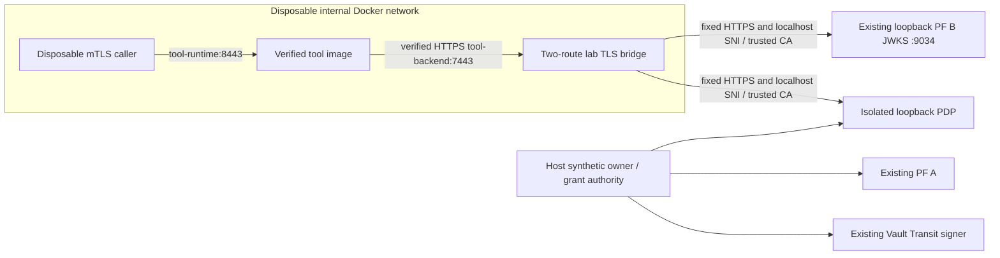

# Actual PF and policy verification inside Docker

This integration runs on the selected existing Windows/Docker host. It connects the verified tool image to actual PF B JWKS and the independent grant-policy service through a temporary private TLS bridge. It is a **lab integration harness**, not a persistent deployment, production egress policy, or verified Copilot-originated call. Microsoft SSO remains UNVERIFIED; Graph/SharePoint remain disconnected.

## Run boundary

`npm run tool:container-test` previews the scope; `npm run tool:container-test -- --run` executes it. Requires the prepared PF pair, selected Vault backend with a valid sign-only runtime lease, current consent OIDC key pins, built `federated-copilot-tool:local` image, Docker Desktop, OpenSSL and free consent test port 9461. It takes roughly three to four minutes including real token aging. No channel credential is loaded and no Microsoft/Graph request occurs.

The runner uses the same exclusive client-mutation lease as the other live suites. It creates an isolated SQLite policy registry and authority/PDP process, temporarily enables only the signed-JWT PF B tool client and preserves PF A's enabled human-login client. It creates only labeled disposable containers/networks, publishes no host ports and removes them afterward.

The tool and caller containers attach only to the internal test network. The bridge additionally uses Docker's existing bridge network to reach the host's loopback services through `host.docker.internal`; it receives no host ports. Docker Desktop host reachability with the approved CA and explicit `localhost` TLS identity was checked first. PF issuer/audience/signature validation is unchanged; only the fixed JWKS transport URI inside the tool becomes `https://tool-backend:7443/pf/JWKS`.

The host's default Docker address pools are exhausted. The harness uses the checked lab-only subnet `10.236.250.0/28` and removes it at completion; Docker rejects a collision rather than silently selecting another network. Existing networks/global Docker configuration are not modified.

## Narrow bridge and workload authentication

The bridge permits exactly `GET /pf/JWKS`, `POST /v1/decisions` and signed `POST /v1/health`. It rejects administrative/token/grant paths, queries, encoded alternatives and arbitrary targets. Its upstream host, JWKS port/path and isolated policy port are fixed controller configuration, never caller input. It preserves the exact signed policy request body and Authorization value, strips unrelated headers, does not follow redirects, bounds bodies/timeouts and logs no request material.

The tool validates the private bridge's certificate against its mounted CA. The bridge separately validates the existing PF/PDP server certificates against the prepared lab CA with the configured `localhost` TLS name. The bridge terminates/re-encrypts backend TLS; the tool API's inbound mTLS still terminates in the tool process.

The policy workload assertion stays signed end to end. `PolicyCaller.decisionOrigin` optionally pins one exact configured HTTPS origin for a decision-only workload. Such a caller can authenticate only `/v1/decisions` and `/v1/health`, with that exact audience, signature, body hash, method, lifetime and persistent replay check. Administrators/consent/authority callers cannot opt into this override. No forwarded header selects the origin.

The bridge is a trusted part of the PDP transport boundary: the policy response is protected by the bridge-to-tool TLS connection, not a separate PDP response signature. This does not claim end-to-end TLS through an untrusted proxy. Production deployment must explicitly approve that termination boundary or use a reviewed end-to-end transport.

For this isolated harness only, `POLICY_TOOL_DECISION_ORIGIN=https://tool-backend:7443` binds the registered `policy-tool` credential to the private route. The host's separate decision-only gateway identity continues to handle token issuance checks at the loopback PDP origin. The default policy profile and existing running consent portal are not reconfigured.

The bridge and probe run as UID/GID 1000 with read-only filesystems, dropped capabilities, no new privileges and bounded CPU/memory/PIDs. The tool image already has those runtime restrictions. The bridge mounts only its disposable TLS key/certificate, public PF CA and numeric policy-port configuration. It receives no policy private key, Vault credential, PF admin credential or database. The tool mounts only its dedicated server TLS material, CA bundles and decision-only PDP credential. Tokens arrive at disposable callers through stdin, never command arguments, files or diagnostic output.

## Verification and cleanup

The suite checks actual interactive/autonomous PF token acceptance inside the built container; invalid/missing workload certificates; invalid/upstream-audience tokens; rejected caller identity/resource overrides; revoked grants; actual token expiry and fresh replacement under the same grant; and backend outage after successful requests/JWKS caching. It also checks the independent PDP's restricted audit records for original human, actor issuer/subject, grant, organisation, mode, scope/resource and receiving audience.

Final verification on 2026-10-30: **31 actual Docker/PF/Vault/PDP checks pass**, **282 production tests pass**, and **207 baseline tests pass**. The final actual run completed at 11:29:10–11:32:52 UTC (22:29:10–22:32:52 AEDT), including readiness outage/recovery checks. Its parent receipt independently confirms clients restored, all consent grants revoked, disposable credentials removed and labeled containers/networks removed. No persistent Compose service was started.

The parent independently checks consent-backed grant states, PF client states, temporary credential removal and labeled container/network removal. Old browser/CSRF state is not the sole cleanup guarantee: before stopping the policy process, it performs a fresh owner-authenticated sweep of remaining grants in that exact isolated run database, without admin authority or new grants. A failed cleanup retains the exclusive lease and reports recovery required.

An earlier run passed the request checks but left one grant active at final browser cleanup; the runner preserved the recovery lock. Fresh owner-authenticated cleanup revoked it, and the implementation now includes that sweep. No token/grant lifetime or authorization check was relaxed. Historical failed/recovered receipts remain available privately.

## Remaining production gates

The bridge is development glue for Docker Desktop's existing loopback lab services. Its second network is not a host-enforced destination firewall; production isolation/egress enforcement and a private routed deployment still require review. Self-generated test certificates and same-user host files are not production PKI/secret custody. No bridge route has been added to Cloudflare or to the unstarted production Compose service.

[Admission/concurrency/rate limits and authenticated readiness](tool-readiness-admission.md) are now implemented and locally verified. Operational audit/alerts, production key/certificate lifecycle and deployment approval remain outstanding. Real Copilot caller authentication and Microsoft secure-token-post acceptance remain independent blockers. This harness proves the local container identity/policy path, not Copilot or Microsoft 365 access.
